# ESPurna Firmware

ESPurna ("spark" in Catalan) is a custom firmware for ESP32 and ESP8285/ESP8266 based smart switches, lights and sensors.
It uses the Arduino Core for ESP32 / ESP8266 frameworks and a number of 3rd party libraries.
This fork adds the [ESP32 and Beken BK72xx ports](#this-fork) and a [hardware list](#hardware) with guides; the badges right below refer to the original upstream project.

[](https://github.com/xoseperez/espurna/releases?expanded=true)
[](https://github.com/xoseperez/espurna/tree/dev/)
[](LICENSE)
[](https://github.com/xoseperez/espurna/actions/workflows/push.yml)
<br />
[](https://github.com/xoseperez/espurna/releases)
[](https://www.paypal.com/cgi-bin/webscr?cmd=_donations&business=xose%2eperez%40gmail%2ecom&lc=US&no_note=0&currency_code=EUR&bn=PP%2dDonationsBF%3abtn_donate_LG%2egif%3aNonHostedGuest)
[](https://app.gitter.im/#/room/#tinkerman-cat_espurna:gitter.im)
[](https://twitter.com/intent/follow?screen_name=xoseperez)

---

## This fork

[](https://github.com/igorufox/espurna/releases/latest)
[](https://github.com/igorufox/espurna/actions/workflows/esp32.yml)
[](https://github.com/igorufox/espurna/tree/esp32-port/)

ESP32 and Beken ports and AC wall-switch support are maintained by **@igorufox**. ESPurna itself is the work of Xose Pérez (**@xoseperez**), Max Prokhorov (**@mcspr**) and the upstream contributors, credited below.

This fork lives in the [`esp32-port`](https://github.com/igorufox/espurna/tree/esp32-port) branch and adds two architectures to the ESP8266 one, from the same source:

- **ESP32** (Arduino-ESP32 core 3 / ESP-IDF 5 via [pioarduino](https://github.com/pioarduino/platform-espressif32), PlatformIO Core 6.2 or newer; Matter On/Off plugs; safeboot flash layout with Tasmota's offsets, [`code/esp32_4mb_safeboot.csv`](code/esp32_4mb_safeboot.csv), and an own safeboot image, [`code/safeboot-app`](code/safeboot-app)), code under [`code/espurna/arch/esp32`](code/espurna/arch/esp32);
- **Beken BK7231N** (Tuya CB2S / CB3S / CBU and compatible modules, Tuya or Quectel bootloader) through [LibreTiny](https://docs.libretiny.eu/), Matter On/Off plugs, code under [`code/espurna/arch/beken`](code/espurna/arch/beken), builds in [`code/platformio_beken.ini`](code/platformio_beken.ini).

The ESP8266 side has generic images instead of the 216 per-board builds: the board is picked after flashing, see [Picking the board](#picking-the-board). How updates work on each chip, the releases and CI: [docs/updates.md](docs/updates.md).

### Hardware

Boards run on the generic image of their chip; pins come from the device template (*ADMIN → Device Template*) or the settings, not from the build. Guides cover the boards that need more than that.

| Device | Chip | Image | Guide |
|--------|------|-------|-------|
| any ESP32 with 4 MB flash | ESP32 | `esp32-matter` | [Tasmota templates](#esp32-tasmota-templates) |
| LC-Tech ESP32 2-relay | ESP32 | `esp32-matter` | relays GPIO16 / GPIO17, button GPIO0, LED GPIO23 (inverted); [settings](#esp32-boards-from-the-settings) |
| Sonoff NSPanel EU (gen1) | ESP32 | `esp32-matter-nspanel` | [Sonoff NSPanel](#sonoff-nspanel), [nspanel/README.md](nspanel/README.md) |
| Sonoff MINIR4 "Mini Extreme" | ESP32 | `esp32-matter` | relay GPIO26, button GPIO0, S1/S2 GPIO27, LED GPIO19 (inverted); [Sonoff MINIR4](#sonoff-minir4), [settings](#esp32-boards-from-the-settings) |
| any BK7231N board, Tuya or Quectel bootloader (CB2S, CB3S, CBU ...) | BK7231N | `beken-matter` | [beken/README.md](beken/README.md) |
| Tuya TYWRA-RF, 1 relay + 433 MHz | BK7231N (CB3S) | `beken-matter` | [beken/README.md](beken/README.md) |
| Tuya 4-gang switch module | BK7231N (CBU) | `beken-matter` | [beken/cbu-4gang.md](beken/cbu-4gang.md) |
| Sparkleiot Mini Smart Switch (Matter) | BK7231M (XH-CB2S) | `beken-matter` | [beken/sparkleiot-mini.md](beken/sparkleiot-mini.md) |
| Moes MS-104B, AC mains wall switches | ESP8266 | `esp8266-1m` | [AC mains wall-switch inputs](#ac-mains-wall-switch-inputs) |
| Sonoff, Shelly and the other boards of `hardware.h` | ESP8266 / ESP8285 | `esp8266-1m`, `-1m-light`, `-1m-sensor`, `-4m` | device template, [which image](#which-image) |

Enabled modules: WebUI, API, MQTT, terminal, Home Assistant; on ESP32 also Domoticz, Alexa, sensors, PWM and Matter; on Beken also Alexa, Domoticz, the 433 MHz receiver and Matter.

### Download

Every push to `esp32-port` is built by [GitHub Actions](https://github.com/igorufox/espurna/actions/workflows/esp32.yml) and published as one [release](https://github.com/igorufox/espurna/releases/latest) for all chips, tag `esp32-YYMMDD-<sha7>`; the newest 5 are kept. The same files with their SHA-256 are listed in [`firmware.json`](https://igorufox.github.io/espurna/firmware.json) on GitHub Pages, which the WebUI reads. There is one image per chip (or per group of drivers on the ESP8266) instead of one per board:

| Image | Files | For |
|-------|-------|-----|
| `esp32-matter` | `-full.bin` (serial, at `0x0`, with the safeboot), `-ota.bin` (updates) | any ESP32 with 4 MB flash, Matter On/Off plugs |
| `esp32-matter-nspanel` | same | Sonoff NSPanel EU (gen1), see [nspanel/README.md](nspanel/README.md) |
| `beken-matter` | `.bin` (updates) | any BK7231N board, Tuya or Quectel bootloader, Matter plugs and 433 MHz receiver included |
| `esp8266-1m` | `.bin` (serial at `0x0` or update), `.bin.gz` (update) | 1 MB boards: relays, buttons (AC mains switches too), LEDs, dummy relays, RF receiver and Sonoff RF Bridge, relay MCUs (Sonoff Dual, STM relays, LightFox, iFan, KingArt curtain), MCP23S08 |
| `esp8266-1m-light` | same | 1 MB, relays, buttons, LEDs + lights (`ltProvider`: PWM dimmer, MY92XX ...), IR, rotary encoder |
| `esp8266-1m-sensor` | same | 1 MB, relays, buttons, LEDs + power meters (HLW8012, CSE7766, V9261F, ECH1560, PZEM-004T, ADE7953), sensors (DHT, Dallas, BMx280, analog, NTC, digital), analog buttons |
| `esp8266-4m` | same | boards installed with the 4 MB layout (their settings sit at the end of 4 MB): relays, buttons, LEDs, RF receiver, MCP23S08 and the drivers of `-1m-sensor` (plus LDR, events, pulse meter); no light, IR, relay MCUs. Every driver costs static RAM even while idle, and with all of them only ~4 KB of heap was left |

Helper images: `esp8266-1m-mini` ([`code/mini-app`](code/mini-app)) - the first step of the two-step update on 1 MB boards, it downloads the full `.bin.gz` itself; `esp32-safeboot` - the safeboot image alone (the WebUI installs it by itself when it differs, and migrates two-slot ESP32 boards with it); `beken-initial-tuya` / `beken-initial-quectel` - the first flash of a Beken chip over UART with `ltchiptool`, one `.uf2` per bootloader.

Every driver of a generic image stays idle until its pins or its port are set: sensor pins (`dhtPin`, `dallasPin`, `ntcPin` ...), `rfbProv` / `rfbRX` (RF), `irRx` / `irRxPreset` (IR), `ltProvider` (light), `relayProv` (relay MCUs). A UART driver (power meters, RF Bridge, relay MCUs) claims the port configured with `uartTx` / `uartRx`; the serial log and terminal stop using that port then, and keep it on boards where nothing claims it. Unknown hardware is safe to flash: no GPIO is driven until configured.

The latest image is always at `https://github.com/igorufox/espurna/releases/latest/download/espurna-<image>...`, e.g. [espurna-esp32-matter-full.bin](https://github.com/igorufox/espurna/releases/latest/download/espurna-esp32-matter-full.bin).

First flash over serial:

```
esptool.py --chip esp32 --baud 460800 write_flash 0x0 espurna-esp32-matter-full.bin
esptool.py --chip esp8266 --baud 460800 write_flash 0x0 espurna-esp8266-1m.bin
```

Beken: `ltchiptool`, see [beken/README.md](beken/README.md#5-flash-espurna).

### Updating

WebUI, *ADMIN*, OTA: *Upgrade* with a file as before, or *From GitHub*, *Show releases*: the kept releases with the files of the image the board runs, *Install*. The WebUI lists the steps ahead and goes through them by itself; the board restarts during the install.

- **ESP32**: through safeboot. The WebUI installs the release's safeboot when its SHA-256 differs, then the board restarts into safeboot, which downloads the `-ota.bin` over https, checks its SHA-256 and boots ESPurna; the result shows in the WebUI. ESP32 boards on the old two-slot layout are migrated over Wi-Fi on the way. The safeboot page (`http://<board>/` while in safeboot, user `admin`, the admin password) lists the releases too.
- **Beken**: the browser downloads `espurna-beken-matter.bin` and uploads it; the board writes the part made for its bootloader. On 2 MiB Tuya boards the same file goes up a second time for the Matter code (the board answers "OK, again"), and once more first when Matter is running.
- **ESP8266**: the browser uploads the file when it fits the free space behind the running image (4 MB layout). On 1 MB boards it uploads the mini first, which downloads the full `.bin.gz` from GitHub over https, checks its SHA-256 and writes it. The mini's page lists the releases as well.

Details, limits and what happens when an install stops half-way: [docs/updates.md](docs/updates.md).

### Picking the board

WebUI, *ADMIN*, *Device Template*: type the name (e.g. `sonoff mini`, `shelly 1pm`, `ms-104b`) and *Apply*. The list is downloaded by the browser at that moment from [templates.blakadder.com](https://templates.blakadder.com) (Tasmota templates, ESP8266 / ESP32), [OpenBeken](https://openbekeniot.github.io/webapp/devicesList.html) (Beken) and [igorufox/espurna-devices](https://github.com/igorufox/espurna-devices) (*ESPurna devices*, results marked `[github]`); nothing is stored here. AC mains wall switches are marked afterwards on the RELAYS panel, per button. Your own board: [add a template](https://templates.blakadder.com/new.html) to the Tasmota list, the `devices.json` of [openbekeniot/webapp](https://github.com/openbekeniot/webapp) for Beken, or an entry of espurna-devices.

**ESPurna devices.** [`devices.json`](https://github.com/igorufox/espurna-devices) holds every ESP8266 board of [`hardware.h`](code/espurna/config/hardware.h) (generated by [`code/scripts/boards_to_devices.py`](code/scripts/boards_to_devices.py), most of them not verified on hardware since the move to generic images) and the no-name boards that are in no other list, such as the [CBU 4-gang module](beken/cbu-4gang.md) and the [Sparkleiot Mini](beken/sparkleiot-mini.md). Another list: the `webTplUrl` setting, *Own device list* in the same panel. A board set up by hand is turned into an entry with *Export this device as a template*: only relay / button / LED / UART / RF pins, button actions and the board names are taken, never Wi-Fi, MQTT, passwords or topics, and only those keys are ever applied from the list.

#### Which image

Every espurna-devices entry names its image; the search result and the *Apply* confirmation show it. The device cannot tell which image it runs, so *Apply* does not check it. For ESP8266 boards:

| The board has | Image |
|---------------|-------|
| relays, buttons, LEDs, AC mains switches, RF receiver, Sonoff RF Bridge, Sonoff Dual / STM relays / LightFox / iFan / KingArt, MCP23S08 | `esp8266-1m` |
| a light (PWM, MY92XX), IR, an encoder | `esp8266-1m-light` |
| a power meter, a sensor, analog buttons | `esp8266-1m-sensor` |
| 4 MB flash and the 4 MB layout of its old build (development boards, ESPurna H, NodeMCU ...) | `esp8266-4m` |

Two boards need two 1 MB images (light and power meter / RF): the Smartlife Mini Smart Socket and the MagicHome ZJ-WFMN-B11 run `esp8266-1m-light`, their other part stays off. 2 MB boards (Shelly 1 / 2 / 1PM / 2.5, Euromate V2) run the 1 MB images, but their settings sit elsewhere in the 2 MB layout: back up the settings (*ADMIN*, *Backup*) before the switch.

Coming from a board build: the generic image reads the pins from the settings. Apply the board's template before the update (it writes the values the build had, nothing changes on the running board) or right after the first boot.

### Build from source

```
cd code
pio run -e esp8266-1m                 # -1m-light, -1m-sensor, -4m
pio run -d mini-app                   # the mini, code/mini-app/.pio/build/esp8266-1m-mini/firmware.bin
pio run -d safeboot-app               # ESP32 safeboot first, it goes into the -full image
pio run -c platformio_esp32.ini -e esp32-generic
```

ESP32: the merged image is written to `code/.pio/build/<build>/espurna-<build>.bin` by [`scripts/esp32_merge.py`](code/scripts/esp32_merge.py): bootloader, partition table, `boot_app0`, the ESPurna safeboot in the factory partition at `0x10000` (832 KB) and ESPurna at `0xE0000`; `firmware.bin` next to it is the `-ota.bin`. Without the safeboot built first ESPurna still runs, only the `safeboot` command refuses to switch. Safeboot reads Wi-Fi, the hostname, the admin password and `webFwUrl` from the ESPurna settings and has none of its own. The `pioarduino` tool installer refuses MSYS: run the ESP32 build outside Git Bash.

Beken builds have their own build directory (`code/.pio/build_beken`) and produce `espurna-beken.bin` (the release's `espurna-beken-matter.bin`) and the two UART images; the Matter library comes from the releases of [igorufox/matter-bk7231n](https://github.com/igorufox/matter-bk7231n), see [beken/README.md](beken/README.md):

```
cd code
py -3 -m platformio run -c platformio_beken.ini -e beken-bk7231n
```

`code/scripts/boards_to_devices.py` regenerates the board entries of `../espurna-devices/devices.json` from `hardware.h` (hand-made entries are kept).

## Device notes

### ESP32: Tasmota templates

Relays, buttons and LEDs are configured at runtime, so any ESP32 device can run the `esp32-matter` image (`esp32-generic` build) and be set up from a [Tasmota template](https://templates.blakadder.com/) - no rebuild needed. The generic image drives no GPIOs until configured, so it is safe to flash on unknown hardware.

1. Flash `espurna-esp32-matter-full.bin` and connect to the device WebUI.
2. Go to **Admin → Device Template**, find the device and press **Apply**, or open *Paste a Tasmota template* there and paste the template JSON, e.g.
   `{"NAME":"MyDevice","GPIO":[0,0,0,0,0,0,0,0,0,0,0,0,224,225,0,0,0,0,0,544,0,0,0,0,0,0,0,0,0,0,0,0,0,0,0,0],"FLAG":0,"BASE":1}`
3. Check the preview (number of relays / buttons / LEDs found), press **Import Tasmota Template** and reboot.

Supported GPIO functions (current Tasmota numbering): `Relay1..32` / `Relay_i` (224-287), `Button1..32` with `n` / `i` / `in` variants (32-159), `Switch1..32` / `Switch_n` (160-223, imported as buttons), `Led1..32` / `Led_i` (288-351), `PWM1..32` / `PWM_i` (416-479, as LEDs), `LedLink` / `LedLinki` (544, 576). Template `NAME` becomes the device description. Other functions (sensors, serial, etc.) are skipped, and the import overwrites existing relay, button and LED settings.

### Sonoff NSPanel

The first Sonoff NSPanel (EU) as a stand-alone wall panel: the screen and what its tiles switch come from one JSON file on the
panel, and it talks MQTT directly to the devices. No Home Assistant, ioBroker or other server; the weather comes from Open-Meteo.

- home screen with clock, weather and forecast, room temperature, MQTT info lines and shortcuts;
- swipeable pages in 4x2, 3x3, 3x2, 2x2 or 1x2 grids or as lists, tiles that open nested pages;
- switches, pulse buttons, scenes over device groups, sensor values, thermostats with a setpoint dial (zigbee2mqtt, Istabai, any JSON);
- the two hardware buttons run group actions; JSON editor with a live preview in the WebUI; English or Russian screen texts.

|||
|---|---|
|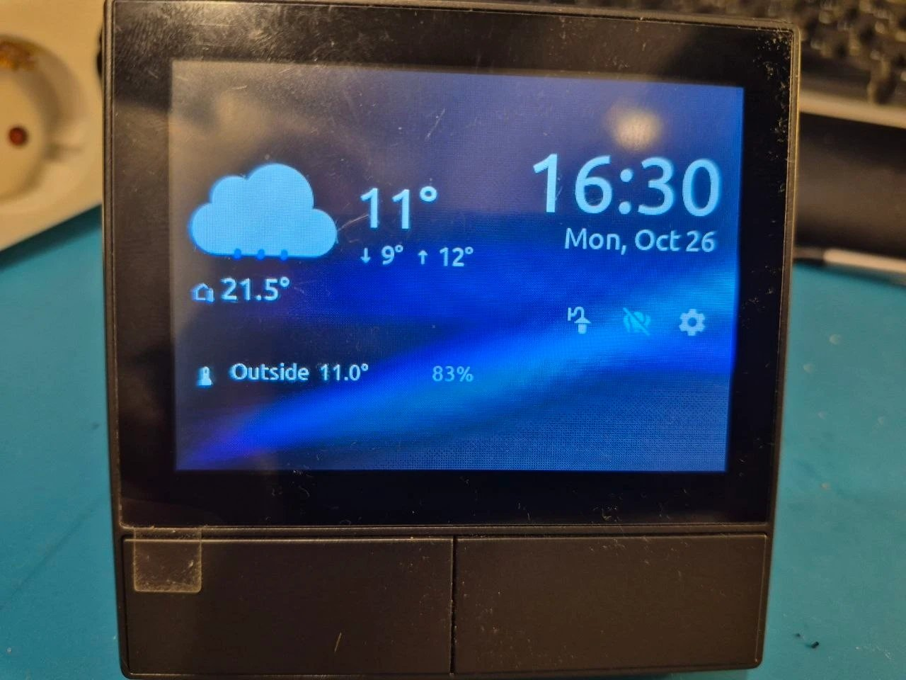|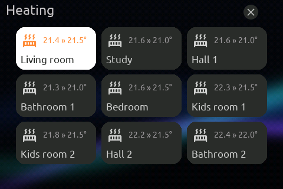|
|the panel: home screen|nine thermostats on a 3x3 page (rendered)|

Setup, the JSON format and more photos: [nspanel/README.md](nspanel/README.md).

### ESP32 boards from the settings

The LC-Tech relay x2 and the MINIR4 had images of their own before; the generic one needs their pins in the settings. Set them before an update from such an image (they match its built-in values, so nothing changes on the running board), or after the first boot of the generic image, from the terminal of the WebUI (*DEBUG*):

- LC-Tech ESP32 2-relay:
  `set relayGpio0 16; set relayGpio1 17; set btnGpio0 0; set btnMode0 pushbutton; set btnDefVal0 high; set btnPinMode0 pull-up; set btnRelay0 0; set ledGpio0 23; set ledInv0 1; set sysManufacturer LC_TECH; set sysDevice ESP32_RELAY_X2`
- Sonoff MINIR4:
  `set relayGpio0 26; set btnGpio0 0; set btnMode0 pushbutton; set btnDefVal0 high; set btnPinMode0 pull-up; set btnRelay0 0; set btnGpio1 27; set btnMode1 switch; set btnPinMode1 pull-up; set btnDefVal1 initial; set btnRelay1 0; set btnPress1 relay-toggle; set btnRlse1 relay-toggle; set ledGpio0 19; set ledInv0 1; set sysManufacturer ITEAD; set sysDevice SONOFF_MINIR4`

### Sonoff MINIR4

Tested on a real MINIR4 (stock eWeLink firmware `FWSW-E32R4-MINIR4`, no Matter in it; the Matter model is the MINIR4M, an ESP32-C3 board that this build does not cover).

- **Serial**: TX, RX, IO0 and GND pads are on the small vertical ESP32 daughter board, 3V3 comes from the U2 pad on the bottom of the main board. Hold the button (GPIO0) while powering up to enter the ROM bootloader.
- **Backup first** if you may want eWeLink back: `esptool.py --chip esp32 read_flash 0 0x400000 stock.bin`.
- **Power**: flashing works from the 3V3 of a USB-UART adapter, booting does not - the board resets (`POWERON_RESET`) every time WiFi starts. Run it from mains with the serial wires removed.
- **Wiring**: the terminal block order differs from the Mini R2, follow the markings on the case.
- The flash layout is the safeboot one of every ESP32 image: an update goes through the ESPurna safeboot, an interrupted update leaves the safeboot to retry from.

|||
|---|---|
|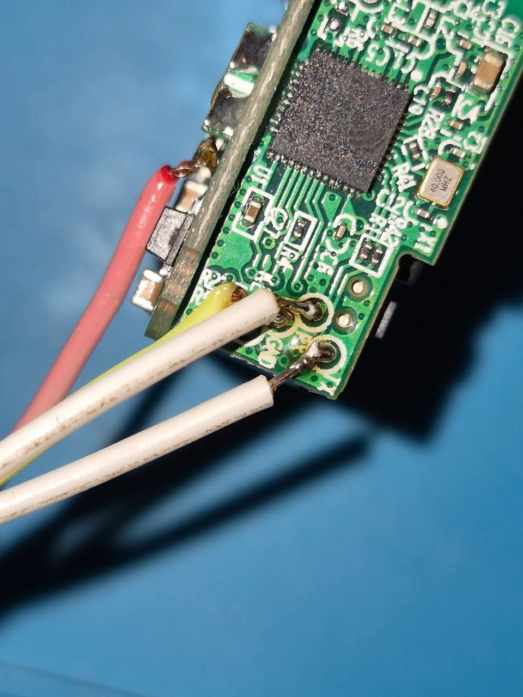|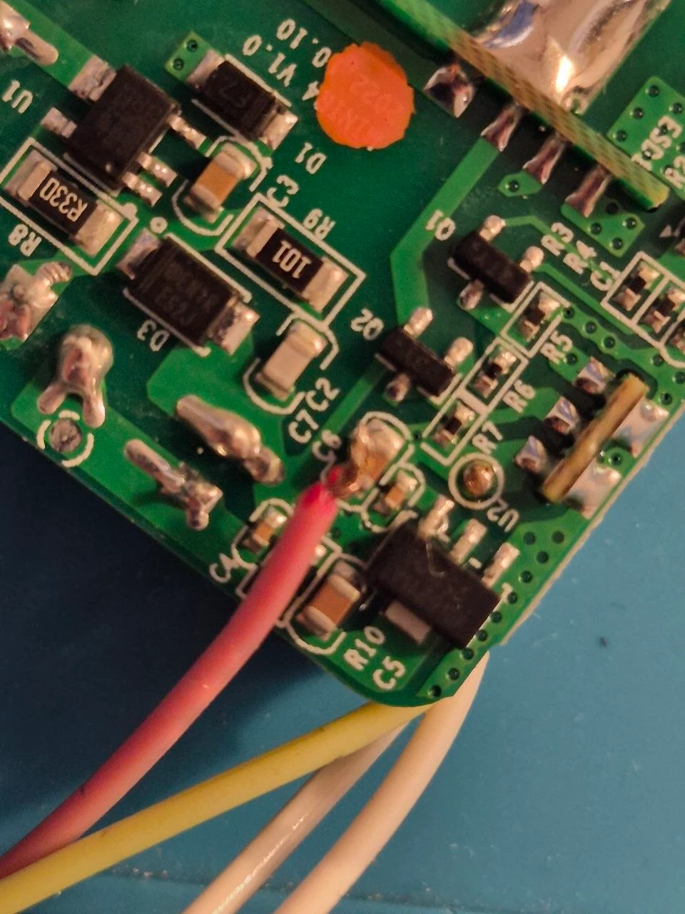|
|serial wires on the ESP32 daughter board|3V3 at the U2 pad, bottom of the main board|

### Beken boards

Most new Tuya devices carry a Beken BK72xx module (CB2S, CB3S, CBU, WB2S) instead of an ESP8266. The first flash goes over UART1 with `ltchiptool` (`espurna-beken-initial-tuya.uf2` or `-initial-quectel.uf2`, per bootloader), after that every update goes over Wi-Fi: `espurna-beken-matter.bin`, the same file for every BK7231N board, from the WebUI release list or uploaded by hand.

|||
|---|---|
|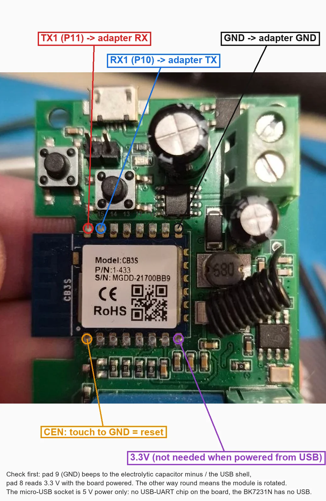|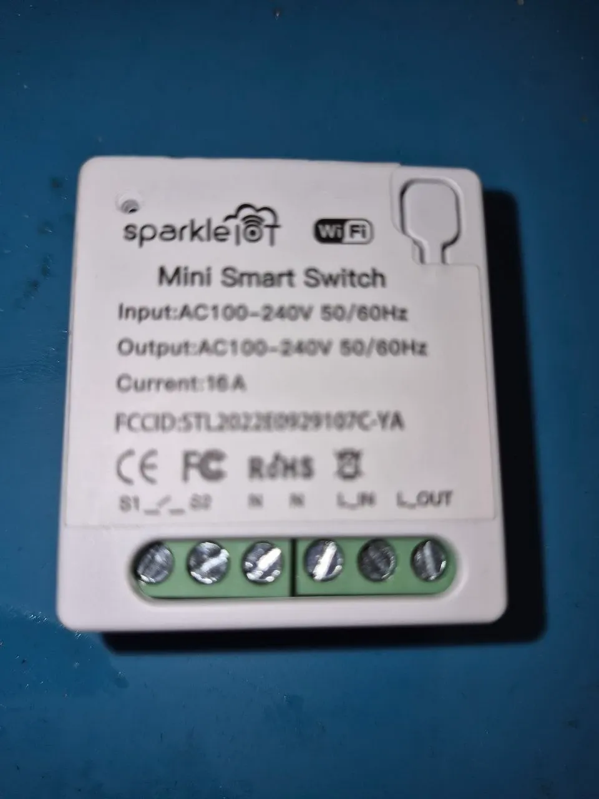|
|Tuya CB3S: TX1, RX1, GND and CEN pads|Sparkleiot Mini: XH-CB2S, no flash encryption, 4 MiB layout|

- [Tuya CB3S and the TYWRA-RF relay](beken/README.md): wiring, backup, flashing, OTA, the 433 MHz remote, known limitations;
- [Tuya 4-gang switch module (CBU)](beken/cbu-4gang.md): relay 1 and the LED on the UART1 pins;
- [Sparkleiot Mini Smart Switch (XH-CB2S, BK7231M)](beken/sparkleiot-mini.md): stock Quectel Matter firmware and its factory Matter identity, Quectel bootloader (4 MiB, no flash encryption), a second wall switch on a test pad.

### AC mains wall-switch inputs

Many in-wall relay modules (e.g. Moes MS-104B) connect the wall switch to a GPIO through an optocoupler, so while the switch is ON the pin sees a 50/60 Hz pulse train instead of a steady level. A button marked as *AC mains switch* counts these edges in a GPIO interrupt and is ON while at least *min pulses* edges were seen within one debounce window (100 ms is recommended), optionally accepting only edges with the 50 or 60 Hz period (either full-wave or half-wave optocoupler circuits). Such a button always works in `switch` mode: the position at boot is taken as the starting point (no toggle at boot) and click / long-click actions are disabled, so a wall switch can never trigger reset or AP mode. Works on both ESP8266 (GPIO0..15) and ESP32 (any input-capable GPIO); on other pin types (ESP8266 GPIO16, expanders, analog) the button is disabled instead, because a plain pin would read the pulses as constant presses and releases.

- **WebUI**: *Relays → Buttons and wall switches* has the global *AC frequency* (Any / 50 / 60 Hz) and *AC debug log*, plus *AC mains switch* and *Min pulses* per button. Changes other than the debug log need a reboot.
- **Tasmota templates**: they cannot express AC inputs (Tasmota uses `SwitchDebounce` ending with 9). Inputs imported from `Switch` codes become `switch` mode buttons toggling the relay with the same Tasmota number on every position change; mark them as *AC mains switch* on the RELAYS panel afterwards. The boards of this firmware in the device search (e.g. Moes MS-104B) already come with it.
- **Settings**: `btnFreq<N>` (AC detection on/off), `btnMinPulses<N>` (default 5), `btnAcFreq` (0 = any, 50, 60), `btnAcDbg` (pulse statistics in the debug log), together with `btnMode<N>=switch`, `btnPress<N>` / `btnRlse<N>=relay-toggle` and `btnDebDel<N>=100`.
- **Moes MS-104B** (ESP8266, 1 MB): the `esp8266-1m` image with the *Moes MS-104B* device template, or the `moes-ms-104b` build (`pio run -e moes-ms-104b`, defined in `code/platformio_override.ini`), with AC switches on GPIO13 / GPIO12 controlling relays on GPIO14 / GPIO15 and the on-board button on GPIO2.

---

# Original ESPurna README

Everything below is the upstream [xoseperez/espurna](https://github.com/xoseperez/espurna) README and describes ESP8266 builds.

## Collaborators (upstream)

Since November 2018, Max Prokhorov (**@mcspr**) is also actively working as a collaborator of the project. 

## Contributors (upstream)

**Without your help this project would not be possible**. I (**@xoseperez**) simply can't spend all the time I wish on ESPurna but luckily I receive a lot of contributions, bug fixes, enhancement suggestions,... from people all around the world. I would like to thank each and every one of you. The [contributors](https://github.com/xoseperez/espurna/graphs/contributors) page shows the ones that have done a PR in the past, but I also get contributions in the issues, by email or via the [gitter ESPurna channel](https://gitter.im/tinkerman-cat/espurna), those I also want to thank.

**Thank you all very much**.

## Notice

> Ladies and gentlemen in the embedded world, use [PlatformIO](https://platformio.org/). If I could offer you only one tip for the future, [PlatformIO](https://platformio.org/) would be it.

> Please use the [gitter ESPurna channel](https://gitter.im/tinkerman-cat/espurna) for support and questions, you have better chances to get fast answers from me or other ESPurna users. Open an issue here only if you feel there is a bug or you want to request an enhancement. Thank you.

> Process of building ESPurna from source is documented in the Wiki:  
[Using PlatformIO IDE for VSCode](https://github.com/xoseperez/espurna/wiki/Build-and-update-from-Visual-Studio-Code-using-PlatformIO)  
[Using PlatformIO CLI](https://github.com/xoseperez/espurna/wiki/PlatformIO)  
[Using Arduino IDE](https://github.com/xoseperez/espurna/wiki/ArduinoIDE)  

## Features

* *KRACK* vulnerability free (when built with Arduino Core >= 2.4.0)
* Support for **multiple ESP8266-based boards** ([check list](https://github.com/xoseperez/espurna/wiki/Hardware))
* Power saving options
* Wifi **AP Mode** or **STA mode**
    * Supports static IP
    * Up to 5 different networks can be defined
    * Scans for strongest network if more than one defined (also available in web UI)
    * Handles correctly multiple AP with the same SSID
    * Defaults to AP mode (also available after double clicking the main button)
    * Support for **WPS** and **Smart Config** (not available in default builds)
* Network visibility
    * Supports mDNS (service reporting and metadata) both server mode and client mode (.local name resolution)
    * Supports NetBIOS, LLMNR and Netbios (when built with Arduino Core >= 2.4.0) and SSDP (experimental)
* Switch management
    * Support for **push buttons** and **toggle switches**
    * Support for **digital** and [**analog**](https://en.wikipedia.org/wiki/Resistor_ladder) buttons
    * Configurable **status on boot** per switch (always ON, always OFF, same as before or toggle)
    * Support for **pulse mode** per switch (normally ON or normally OFF) with configurable time
    * Support for **relay synchronization** (all equal, only one ON, one and only on ON)
    * Support for **MQTT groups** to sync switches between devices
    * Support for **delayed ON/OFF**
    * Support for **latched relays**
* **MQTT** enabled
    * **SSL/TLS support** (not on regular builds, see [#64](https://github.com/xoseperez/espurna/issues/64) and [#1465](https://github.com/xoseperez/espurna/issues/1465))
    * Switch on/off and toggle relays, group topics (sync relays between different devices)
    * Report button event notifications
    * Enable/disable pulse mode
    * Change LED notification mode
    * Remote reset the board
    * Fully configurable in webUI (broker, user, password, QoS, keep alive time, retain flag, client ID)
* **Scheduler** to automatically turn on, off or toggle any relay at a given time and day, also change light intensity for dimmers
* **Alexa** integration using the [FauxmoESP Library](https://bitbucket.org/xoseperez/fauxmoesp)
* [**Google Assistant**](http://tinkerman.cat/using-google-assistant-control-your-esp8266-devices/) integration using IFTTT and Webhooks (Google Home, Allo)
* [**Domoticz**](https://domoticz.com/) integration via MQTT
* [**Home Assistant**](https://home-assistant.io/) integration
    * Support for switches (on/off)
    * Support for lights (color, brightness, on/off state)
    * Supports MQTT auto-discover feature (switches, lights and sensors)
    * Integration via MQTT Discover or copy-pasting configuration code
* [**InfluxDB**](https://www.influxdata.com/) integration via HTTP API
* [**Prometheus**](https://prometheus.io/) metrics integration via HTTP API
* [**Thingspeak**](https://thingspeak.com/) integration via HTTP API (HTTPS available for custom builds)
* **Sonoff RF Bridge** support
    * Multiple virtual switches (tested with up to 16)
    * MQTT-to-RF two-way bridge (no need to learn codes)
    * Support for [https://github.com/Portisch/RF-Bridge-EFM8BB1](https://github.com/Portisch/RF-Bridge-EFM8BB1) custom firmware
    * Support for [direct control of the encoder/decoder bypassing the EFM8BB1](https://github.com/xoseperez/espurna/wiki/Hardware-Itead-Sonoff-RF-Bridge---Direct-Hack)
* Support for [different **sensors**](Sensors)
    * Environment
        * **DHT11 / DHT12 / DHT22 / DHT21 / AM2301 / Itead's SI7021**
        * **BMP180**, **BMP280** and **BME280** pressure, humidity (BME280) and temperature (BMP280 & BME280) sensor by Bosch
        * **BME680** pressure, humidity, temperature and gas sensor by Bosch with support for Bosch's proprietary library BSEC for accurate Indoor Air Quality (IAQ) monitoring (⚠️ [learn more](https://github.com/xoseperez/espurna/wiki/Sensors#bme680-environmental-sensor))
        * **TMP35** and **TMP36** analog temperature sensors
        * **MAX6675** temperature sensor
        * **NTC** temperature sensors
        * **SI7021** temperature and humidity sensor
        * **SHT3X** temperature and humidity sensor over I2C (Wemos shield)
        * **AM2320** temperature and humidity sensor over I2C
        * **Dallas OneWire sensors** like the DS18B20
        * **MHZ19** CO2 sensor
        * **T6613** CO2 sensor
        * **MICS2710** CO2 & NO2 sensor
        * **MICS5525** CO & CO2 sensor
        * **SenseAir S8** CO2 sensor
        * **PMSX003/PMS5003T/ST** dust sensors
        * **SDS011** dust sensor
        * **BH1750** luminosity sensor
        * **GUVAS12SD** UV sensor
        * **VEML6075** UV Sensor
        * **EZO pH Circuit**
        * **Geiger counter** by RH Electronics
        * **HC-SR04**, **SRF05**, **SRF06**, **DYP-ME007**, **JSN-SR04T** & **Parallax PING)))™** distance sensors
        * **VL53L1X** distance sensor
        * **MAX6675** K-thermocouple-to-digital converter
        * **NTC** thermistor
        * **LDR** light-dependent resistor sensor
    * Power monitoring
        * **HLW8012** using the [HLW8012 Library](https://bitbucket.org/xoseperez/hlw8012) (Sonoff POW)
        * **CSE7766** and **CSE7759B** power monitor chips
        * **HJL-01** and **BL0937** power monitor chips
        * Non-invasive **current sensor** using **internal ADC** or **ADC712** or **ADC121** or **ADS1015** / **ADS1115**
        * **V9261F** power monitor chip
        * **PZEM0004T**  power monitor board
        * **ECH1560** power monitor chip
        * **ADE7953** power monitor chip
    * Raw **analog** and **digital** sensors
    * Simple **pulse counter** with **event triggering** option
    * Support for (almost) any UART based sensor via the **UART-to-MQTT module**
    * Support for different units (Fahrenheit or Celsius, Watts or Kilowatts, Joules or kWh)
* Support for LED lights
    * MY92XX-based light bulbs and PWM LED strips (dimmers) up to 5 channels (RGB, cold white and warm white, for instance)
    * Support for CCT lights
    * RGB and HSV color codes supported
    * Manage channels individually
    * Temperature color supported (in [mired](https://en.wikipedia.org/wiki/Mired) and [kelvin](https://en.wikipedia.org/wiki/Color_temperature)) via MQTT / REST API
    * Flicker-free PWM management
    * Soft color transitions
    * Color synchronization between light using MQTT
    * Option to have separate switches for each channel
* Support for simple 433MHz RF receivers
* Support for UART-to-MQTT bidirectional bridge
* Fast asynchronous **HTTP Server** and cool **Web User Interface**
    * Configurable port
    * Basic authentication
    * Web-based configuration
    * Relay switching and sensor data from the web interface
    * Handle color, brightness, and white/warm channels for lights
    * Websockets-based communication between the device and the browser
    * Backup and restore settings option
    * Upgrade firmware from the web interface
    * Works great behind a [secured reverse proxy](http://tinkerman.cat/secure-remote-access-to-your-iot-devices/)
* **REST API** (enable/disable from web interface)
    * GET and PUT relay status (including pulses)
    * Change light color (for supported hardware)
    * GET sensor data (power, current, voltage, temperature and humidity) depending on the available hardware
    * Works great behind a secured reverse proxy
* **RPC API** (enable/disable from web interface)
    * Remote reset the board
* **RPN Rules - on-device automation**
    * Relays on/off/toggle
    * Lights control
    * Publish / subscribe to MQTT
    * RF receiver integration
* **Over-The-Air** (OTA) updates even for 1Mb boards
    * Manually from PlatformIO or Arduino IDE
    * Automatic updates through the [NoFUSS Library](https://bitbucket.org/xoseperez/nofuss)
    * Update from web interface using pre-built images
* **Command line configuration**
    * Change configuration
    * Run special commands
* **Telnet support**
    * Enable/disable via the web UI
    * Shows debug info and allows to run terminal commands
* **NTP** for time synchronization
    * Supports worldwide time zones
    * Compatible with DST (based on [POSIX TZ variable](https://www.gnu.org/software/libc/manual/html_node/TZ-Variable.html) support)
* **Unstable system check**
    * Detects unstable system (crashes on boot continuously) and defaults to a stable system
    * Only WiFi AP, OTA and Telnet available if system is flagged as unstable
* Configurable LED notifications based on WiFi status, relays status or MQTT messages.
* Button interface
    * Click to toggle relays
    * Double click to enter AP mode (only main button)
    * Long click (>1 second) to reboot device (only main button)
    * Extra long click (>10 seconds) to go back to factory settings (only main button)
    * Specific definitions for touch button devices (ESPurna Switch, Sonoff Touch & T1)
* Configuration stored in different flash sectors to prevent data loss and corruption
* **Garland** Implementing garland using WS2812 leds
    * 12 animation modes (include start animation)
    * Web control for:
        * ON/OFF, brightness, speed
    * MQTT control:
        * ON/OFF, brightness, speed
        * Animation queue
        * Animation sequence

## Notices

---
> **2018-04-08**<br />
> Please use [gitter](https://gitter.im/tinkerman-cat/espurna) for support and questions, you have better chances to get fast answers by me or other ESPurna users. Open an issue here only if you feel there is a bug or you want to request an enhancement. Thank you.

---
> **2018-03-09**<br />
> Default branch in GitHub is now the development branch "dev".<br>
> The stable branch (the one used to create the [binary releases](https://github.com/xoseperez/espurna/releases)) is "[master](https://github.com/xoseperez/espurna/tree/master)".

---
> **2018-01-24**<br />
> This repository has been migrated from Bitbucket to GitHub. There were a number of reason to migrate the repository to GitHub. I like Bitbucket and I'm still using it for a lot of projects, but ESPurna has grown and its community as well. Some users have complain about Bitbucket not being enough community-focused. This change is mainly aimed to use a platform with greater acceptance on the open-source community and tools better suited to them (to you), like the possibility to contribute to the documentation in an easy way.
>
>What happened with all the info in Bitbucket? Well, most of it has been ported to GitHub, albeit with some quirks:
>
>* **Code** has, of course been migrated completely
>* **Issues** are all on GitHub already **but** all issues and comments show up as reported by me. The original reporter is referenced inside the body of the issue (or comment) with a link to his/her profile at Bitbucket and a link to his/her profile at GitHub if it happens to be the same username. I **suggest all reporters to subscribe to the issues they originally filed** (search for your BitBucket username to list them).
>* **Pull requests** historic has not been migrated. At the moment of the migration all pull-requests have been either merged or declined. Of course, those PR merged are in the code base, but the historic and comments in the PR pages will be lost.
>* **Documentation** it's on it way, first step will be to migrate existing wiki, maybe with a new TOC structure
>* **Watchers**, **Forks**, I'm afraid they are all gone. Visit the new repo home and click on the "Watch" button on the top right. And as you do it click also on the "Star" button too :)
>
>I apologize for any inconvenience this migration may have caused. I have decided to do it the hard way.

---
> **2018-01-11**<br />
> As of current version (1.12.0) ESPurna is tested using Arduino Core 2.3.0 and it's meant to be built against that version.

---
> **2017-08-26**<br />
> Since version 1.9.0 the default **MQTT topics for commands have changed**. They all now end with "/set". This means you will have to change your controller software (Node-RED or alike) to send messages to -for instance- "/home/living/light/relay/0/set". The device will publish its state in "/home/living/light/relay/0" like before.

---
> **2017-07-24**<br />
> Default flash layout changed in 1.8.3, as an unpredicted consequence devices will not be able to persist/retrieve configuration if flashed with 1.8.3 via **OTA** from **PlatformIO**. Please check issue [#187](https://github.com/xoseperez/espurna/issues/187).

---

## Contribute

There are several ways to contribute to ESPurna development. You can contribute to the repository by doing:

* Pull requests (fixes, enhancements, new features... are very welcome)
* Documentation (I reckon I'm bad at it)
* Testing (filing issues or help resolving them, they take a lot of time and sometimes I don't have the required hardware to test them all)

And of course you can always buy me a beer, coffee, tea,... via the donation button below.

[](https://www.paypal.com/cgi-bin/webscr?cmd=_donations&business=xose%2eperez%40gmail%2ecom&lc=US&no_note=0&currency_code=EUR&bn=PP%2dDonationsBF%3abtn_donate_LG%2egif%3aNonHostedGuest)

## Documentation

For more information please refer to the [ESPurna Wiki](https://github.com/xoseperez/espurna/wiki).

## Supported hardware

Here is the list of supported hardware. For more information please refer to the [ESPurna Wiki Hardware page](https://github.com/xoseperez/espurna/wiki/Hardware), search for wiki pages starting with *Hardware-...*, or search throught [our build configuration files with hardware presets](https://github.com/xoseperez/espurna/blob/dev/code/espurna/config/hardware.h).

### Power monitoring devices

||||
|---|---|---|
|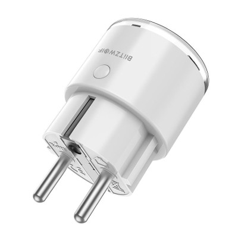|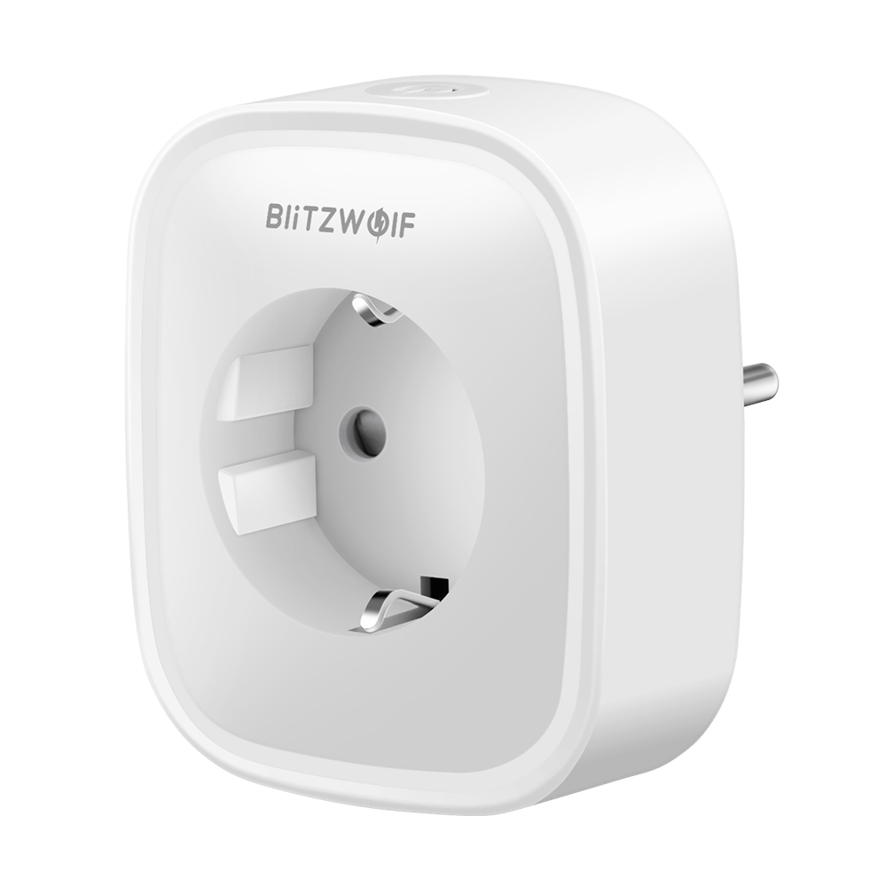|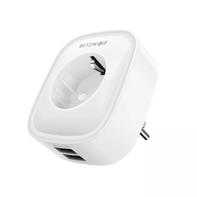|
|**Blitzwolf BW-SHP6**|**[Blitzwolf BW-SHP2](https://github.com/xoseperez/espurna/wiki/Hardware-BLITZWOLF-BW-SHP2)**<br />(also by Coosa, Gosund, HomeCube, Teckin)|**Blitzwolf BW-SHP5**|
|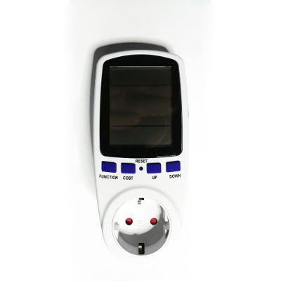|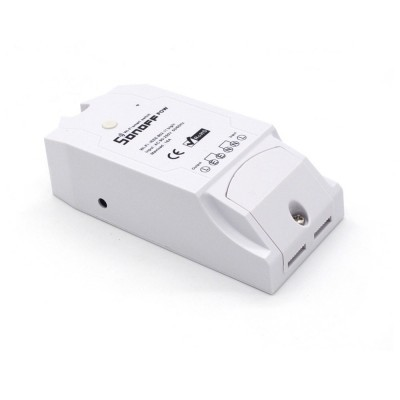|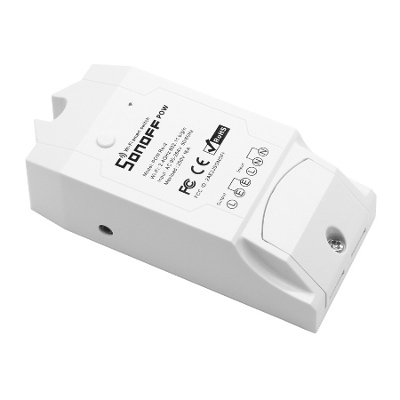|
|**[Power meters based on V9261F](https://github.com/xoseperez/espurna/wiki/Hardware-Generic-V9261F)**|**[Itead Sonoff POW](https://github.com/xoseperez/espurna/wiki/Hardware-Itead-Sonoff-POW)**|**[Itead Sonoff POW R2](https://github.com/xoseperez/espurna/wiki/Hardware-Itead-Sonoff-POW-R2)**|
|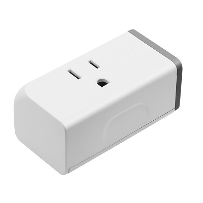|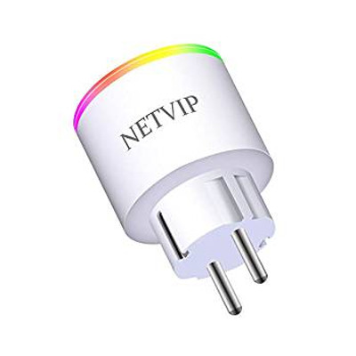|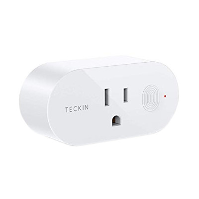|
|**[Itead Sonoff S31](https://github.com/xoseperez/espurna/wiki/Hardware-Itead-Sonoff-S31)**|**Smartlife (NETVIP) Mini Smart Socket**|**Teckin SP20**|
|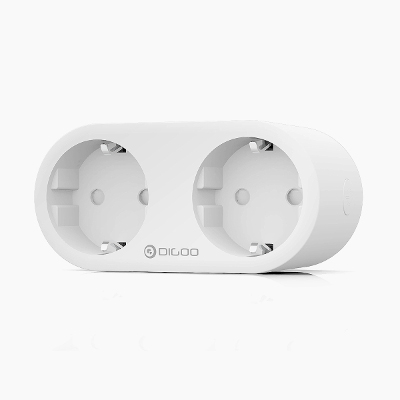|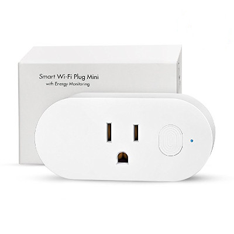|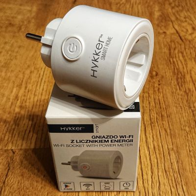|
|**Digoo NX SP202**|**Vanzavanzu Smart WiFi Plug Mini**|**Hykker Smart Home Power Plug**|

### Embedded switches

||||
|---|---|---|
|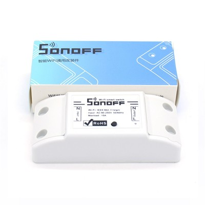|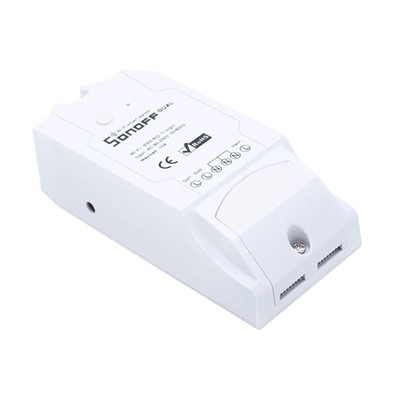|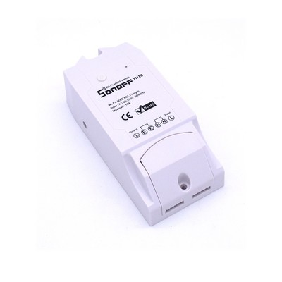|
|**[Itead Sonoff Basic (including R2 and R3)](https://github.com/xoseperez/espurna/wiki/Hardware-Itead-Sonoff-Basic)**|**[Itead Sonoff Dual/Dual R2](https://github.com/xoseperez/espurna/wiki/Hardware-Itead-Sonoff-Dual)**|**[Itead Sonoff TH10/TH16](https://github.com/xoseperez/espurna/wiki/Hardware-Itead-Sonoff-TH)**|
|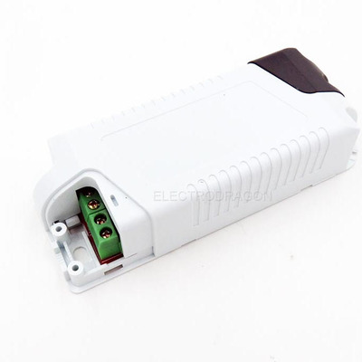|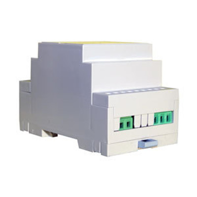||
|**[Electrodragon WiFi IOT](https://github.com/xoseperez/espurna/wiki/Hardware-Electrodragon-ESP-Relay-Board)**|**[OpenEnergyMonitor WiFi MQTT Relay / Thermostat](https://github.com/xoseperez/espurna/wiki/Hardware-OpenEnergyMonitor-Wifi-MQTT-Relay)**||
|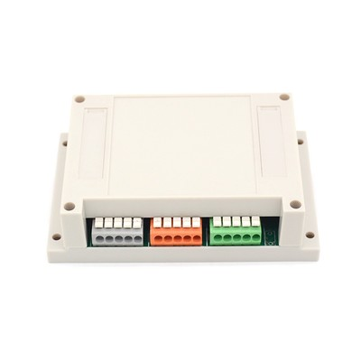|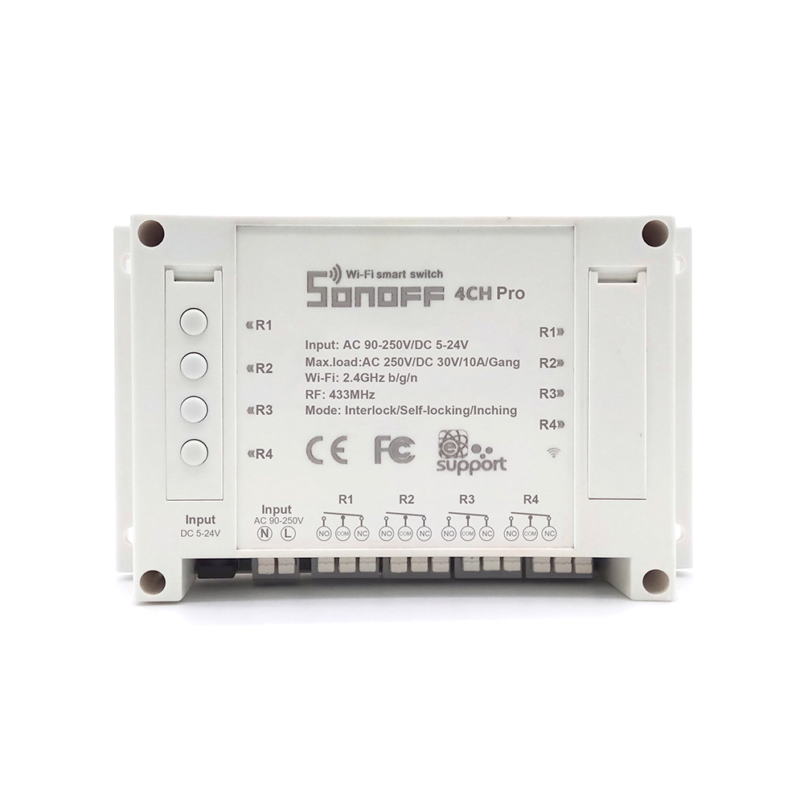||
|**[Itead Sonoff 4CH](https://github.com/xoseperez/espurna/wiki/Hardware-Itead-Sonoff-4CH)**|**[Itead Sonoff 4CH Pro](https://github.com/xoseperez/espurna/wiki/Hardware-Itead-Sonoff-4CH-Pro---R2)**||
|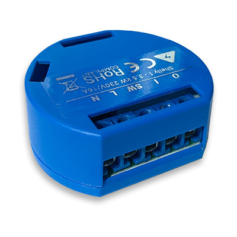|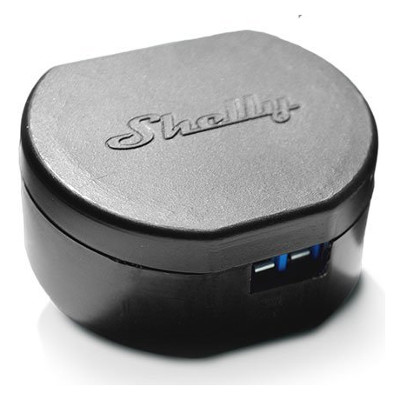|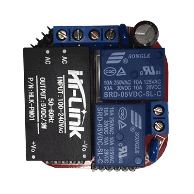|
|**Alterco Shelly 1 / 1PM**|**Alterco Shelly 2 / 2.5**|**[Jan Goedeke Wifi Relay (NO/NC)](https://github.com/xoseperez/espurna/wiki/Hardware-Jan-Goedeke-Wifi-Relay-Board)**|
|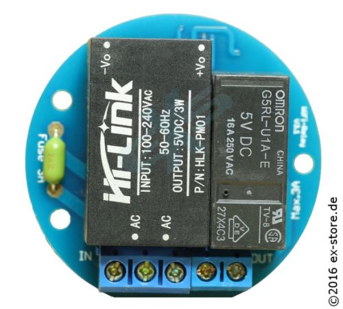|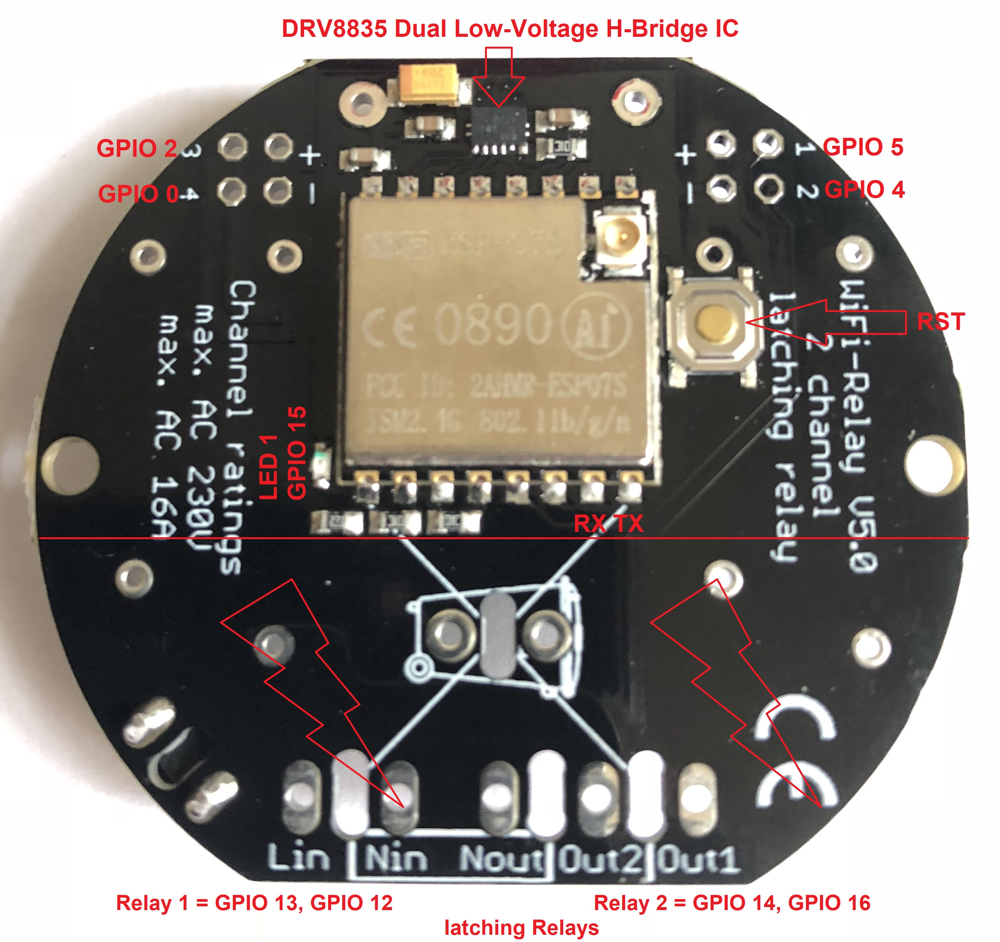|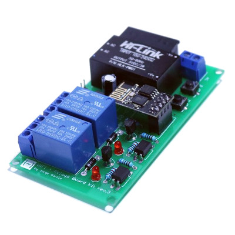|
|**[EXS Wifi Relay v3.1](https://github.com/xoseperez/espurna/wiki/Hardware-EXS-WiFi-Relay-v3.1)**|**EXS Wifi Relay v5.0**|**[Jorge García Wifi + Relays Board Kit](https://github.com/xoseperez/espurna/wiki/Hardware-Jorge-Garcia-Wifi-Relay-Board)**|
|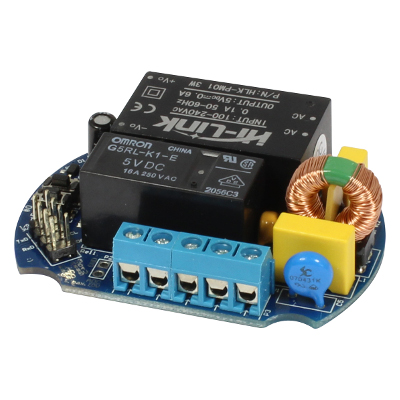|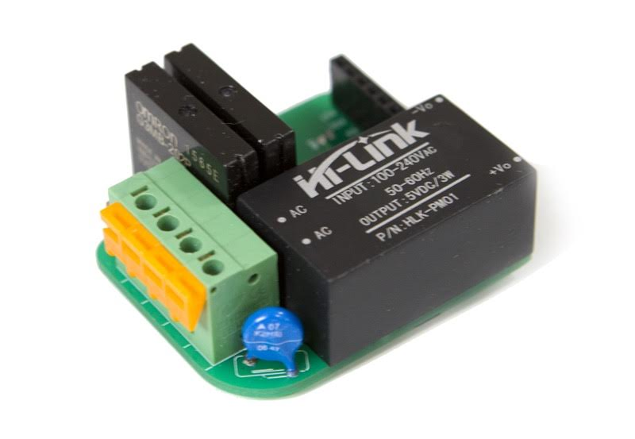|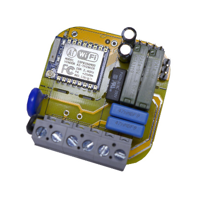|
|**Allnet ESP8266-UP-Relay**|**Bruno Horta's OnOfre**|**Luani HVIO**|


### Wall Sockets

||||
|---|---|---|
|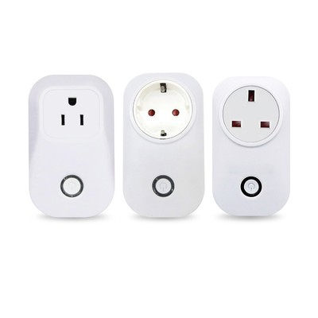|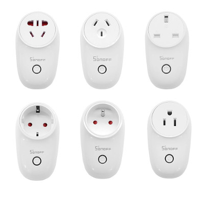|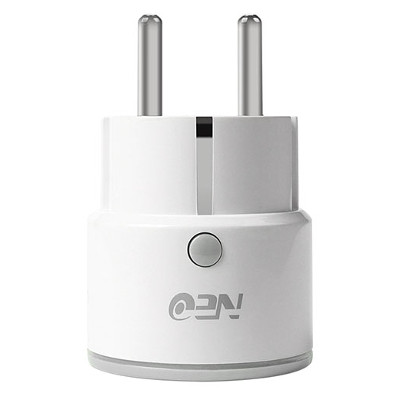|
|**[Itead S20](https://github.com/xoseperez/espurna/wiki/Hardware-Itead-S20)**|**[Itead S26](https://github.com/xoseperez/espurna/wiki/Hardware-Itead-S26)**|**[Neo Coolcam NAS WR01W](https://github.com/xoseperez/espurna/wiki/Hardware-NEO-COOLCAM-NAS-WR01W)**|
|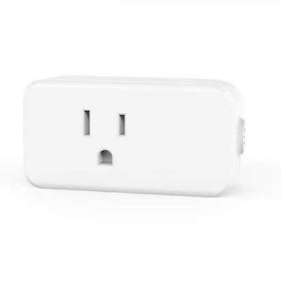|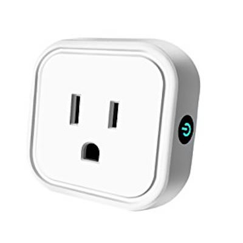|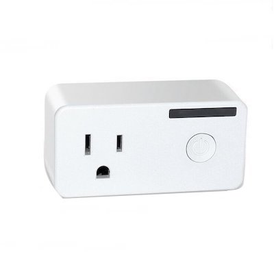|
|**[Maxcio W-US002S](https://github.com/xoseperez/espurna/wiki/Hardware-Maxcio-W-US002S)**|**[HEYGO HY02](https://github.com/xoseperez/espurna/wiki/Hardware-HEYGO-HY02)**|**[YiDian XS-SSA05](https://github.com/xoseperez/espurna/wiki/Hardware-YiDian-XS-SSA05)**|
|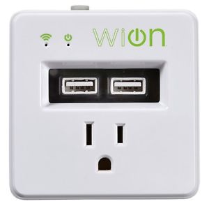|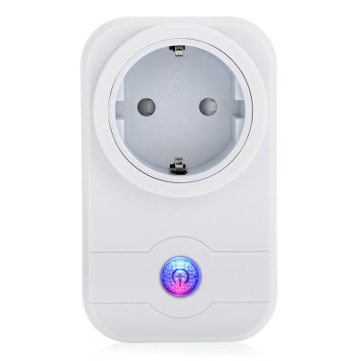|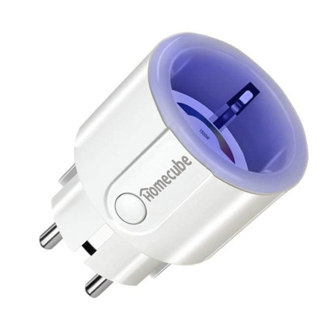|
|**[WiOn 50055](https://github.com/xoseperez/espurna/wiki/Hardware-WiOn-50055)**|**[LINGAN SWA1](https://github.com/xoseperez/espurna/wiki/Hardware-LINGAN-SWA1)**|**HomeCube 16A**|
|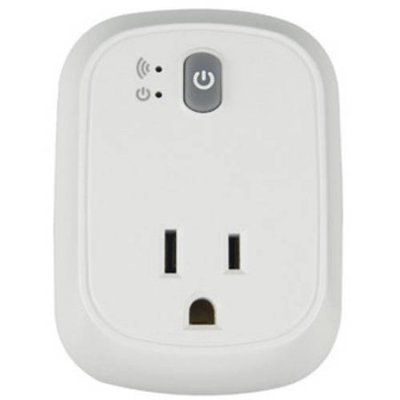|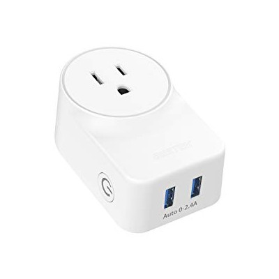|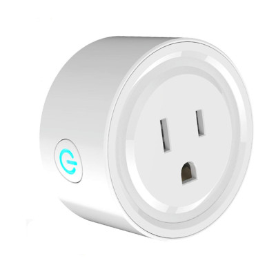|
|**[WorkChoice EcoPlug](https://github.com/xoseperez/espurna/wiki/Hardware-WorkChoice-EcoPlug)**|**[Bestek MRJ1011](https://github.com/xoseperez/espurna/wiki/Hardware-Bestek-MRJ1011)**|**Tonbux XS-SSA01**|
|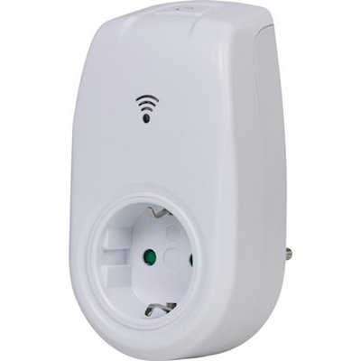|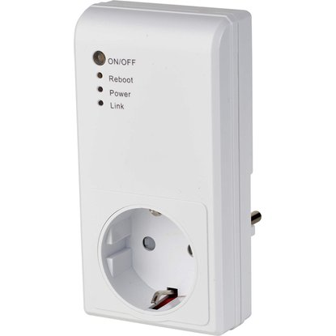|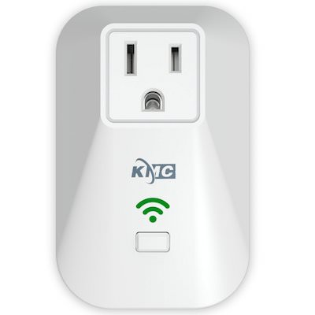|
|**Schuko Wifi Plug**|**Schuko Wifi Plug V2**|**[KMC 70011](https://github.com/xoseperez/espurna/wiki/Hardware-KMC-70011)**|
|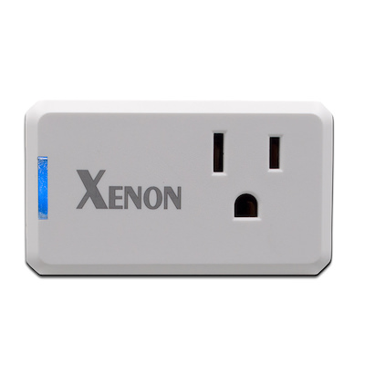|||
|**[Xenon SM-PW702U](https://github.com/xoseperez/espurna/wiki/Hardware-Xenon-SM-PW-702U)**|**[Orvibo B25](https://github.com/xoseperez/espurna/wiki/Hardware-Orvibo-B25)**|**Oukitel P1**|
||||
|**[Tonbux XS-SSA06](https://github.com/xoseperez/espurna/wiki/Hardware-Tonbux-XS-SSA06)**|**Litesun LA-WF3**|**[Maxcio W DE-004](https://github.com/xoseperez/espurna/wiki/Hardware-Maxcio-W-DE004)**|
||||
|**[Hama WiFi Steckdose](https://github.com/xoseperez/espurna/wiki/Hardware-Hama-WiFi-Steckdose,-3.500W,-16A-(Article-Number-00176533))**|**GBLife RGBW Socket**||

### Wall switches

||||
|---|---|---|
||||
|**[Itead Sonoff Touch](https://github.com/xoseperez/espurna/wiki/Hardware-Itead-Sonoff-Touch)**|**[Itead Sonoff T1](https://github.com/xoseperez/espurna/wiki/Hardware-Itead-Sonoff-T1)**|**YJZK 1/2/3-gangs switch**|
||||
|**Gosund WS1 / KS-602S**|||

### Power strips

||||
|---|---|---|
||||
|**[Tonbux PowerStrip02](https://github.com/xoseperez/espurna/wiki/Hardware-Tonbux-Powerstrip02)**|**Fornorm Power Strip**|**[Zhilde ZLD-44EU-W/ZLD-64EU-W](https://github.com/xoseperez/espurna/wiki/Hardware-Zhilde-ZLD-64EU-W)**|

### Smart lights

||||
|---|---|---|
||||
|**[Itead Slampher](https://github.com/xoseperez/espurna/wiki/Hardware-Itead-Slampher)**|**[Arilux E27](https://github.com/xoseperez/espurna/wiki/Hardware-Arilux-E27)**|**[Itead Sonoff B1](https://github.com/xoseperez/espurna/wiki/Hardware-Itead-Sonoff-B1)**|
||||
|**[AI-Thinker Wifi Light / Noduino OpenLight](https://github.com/xoseperez/espurna/wiki/Hardware-AI-Thinker-AI-Light)**|**Authometion LYT8266**|**AG-L4**|
||||
|**Lohas 9W**|**Xiaomi Smart Desk Lamp**|**[iWoole LED Table Lamp](https://github.com/xoseperez/espurna/wiki/Hardware-IWOOLE_LED_TABLE_LAMP)**|
||||
|**[Itead Sonoff LED](https://github.com/xoseperez/espurna/wiki/Hardware-Itead-Sonoff-LED)**|**[Itead BN-SZ01](https://github.com/xoseperez/espurna/wiki/Hardware-Itead-BN-SZ01)**|**[Lombex LUX Nova 2 (white and color)](https://github.com/xoseperez/espurna/wiki/Hardware-Lombex-Lux-Nova)**|
||||
|**Arilux AL-LC01 (RGB)**|**Arilux AL-LC02 (RGBW)**|**[Arilux AL-LC06 (RGBWWCW)](https://github.com/xoseperez/espurna/wiki/Hardware-Arilux-AL-LC06)**|
||||
|**Arilux AL-LC11 (RGBWWW) & RF**|**[MagicHome LED Controller (1.0/2.x, also ZJ WFMN A/B11)](https://github.com/xoseperez/espurna/wiki/Hardware-Magic-Home-LED-Controller)**|**[Huacanxing H801/802](https://github.com/xoseperez/espurna/wiki/Hardware-Huacanxing-H80x)**|
||
|**[Muvit I/O MIOBULB001](https://github.com/xoseperez/espurna/wiki/Hardware-Muvit-IO-miobulb001)**|**[Lampi Battery Powered Smart Light](https://github.com/xoseperez/espurna/wiki/Hardware-Lampi-RGBWW-Battery-Powered-Smart-Light)**|

### Radio links / gateways

||||
|---|---|---|
||||
|**Tinkerman RFM69GW**|**[Itead Sonoff RF Bridge](https://github.com/xoseperez/espurna/wiki/Hardware-Itead-Sonoff-RF-Bridge)**|**[Itead Sonoff RF](https://github.com/xoseperez/espurna/wiki/Hardware-Itead-Sonoff-RF)**|

### Other devices

||||
|---|---|---|
||||
|**[Tonbux Mosquito Killer](https://github.com/xoseperez/espurna/wiki/Hardware-Tonbux-Mosquito-Killer)**|**Itead Sonoff IFAN02**|||

### Custom & Development boards

||||
|---|---|---|
||||
|**[Tinkerman ESPurna H](https://github.com/xoseperez/espurna/wiki/Hardware-Tinkerman-ESPurna-H)**||**[NodeMCU Lolin V3](https://github.com/xoseperez/espurna/wiki/Hardware-NodeMCU-Lolin)**|
||||
|**[Itead Sonoff SV](https://github.com/xoseperez/espurna/wiki/Hardware-Itead-SV)**|**[Itead 1CH Inching](https://github.com/xoseperez/espurna/wiki/Hardware-Itead-1CH)**|**[Itead Motor Clockwise/Anticlockwise](https://github.com/xoseperez/espurna/wiki/Hardware-Itead-Motor)**|
||||
|**[ManCaveMade ESP-Live](https://github.com/xoseperez/espurna/wiki/Hardware-ManCaveMade-ESPLive)**|**[Wemos D1 Mini Relay Shield](https://github.com/xoseperez/espurna/wiki/Hardware-Wemos-D1-Mini-Relay-Shield)**|**[Gizwits Witty Cloud](https://github.com/xoseperez/espurna/wiki/Hardware-Witty-Cloud)**|
||||
|**[IKE ESPike](https://github.com/xoseperez/espurna/wiki/Hardware-IKE-ESPike)**|**Pilotak ESP DIN**|**[Arniex Swifitch](https://github.com/xoseperez/espurna/wiki/Hardware-Arniex-Swifitch)**|
||||
|**[Heltec Touch Relay](https://github.com/xoseperez/espurna/wiki/Hardware-Heltec-Touch-Relay)**|**[Generic Relay v4.0](https://github.com/xoseperez/espurna/wiki/Hardware-Generic-Relay-v40)**|**[Generic RGBLed v1.0](https://github.com/xoseperez/espurna/wiki/Hardware-Generic-RGBLed-v10)**|
||||
|**[Generic DHT11 v1.0](https://github.com/xoseperez/espurna/wiki/Hardware-Generic-DHT11-v10)**|**[Generic DS18B20 v1.0](https://github.com/xoseperez/espurna/wiki/Hardware-Generic-DS18B20-v10)**|**[InterMitTech QuinLED 2.6](https://github.com/xoseperez/espurna/wiki/Hardware-QuinLED)**|
||||
|**Phyx ESP12 RGBW**|**[RH Electronics Geiger Counter](https://github.com/xoseperez/espurna/wiki/Geiger-Counter)**|**[Green ESP Relay](https://github.com/xoseperez/espurna/wiki/Hardware-Green-ESP8266-Relay)**|
||||
|**Foxel Lightfox Dual**|||

## License

Copyright (C) 2016-2019 by Xose Pérez (@xoseperez)

This program is free software: you can redistribute it and/or modify
it under the terms of the GNU General Public License as published by
the Free Software Foundation, either version 3 of the License, or
(at your option) any later version.

This program is distributed in the hope that it will be useful,
but WITHOUT ANY WARRANTY; without even the implied warranty of
MERCHANTABILITY or FITNESS FOR A PARTICULAR PURPOSE.  See the
GNU General Public License for more details.

You should have received a copy of the GNU General Public License
along with this program.  If not, see <http://www.gnu.org/licenses/>.
