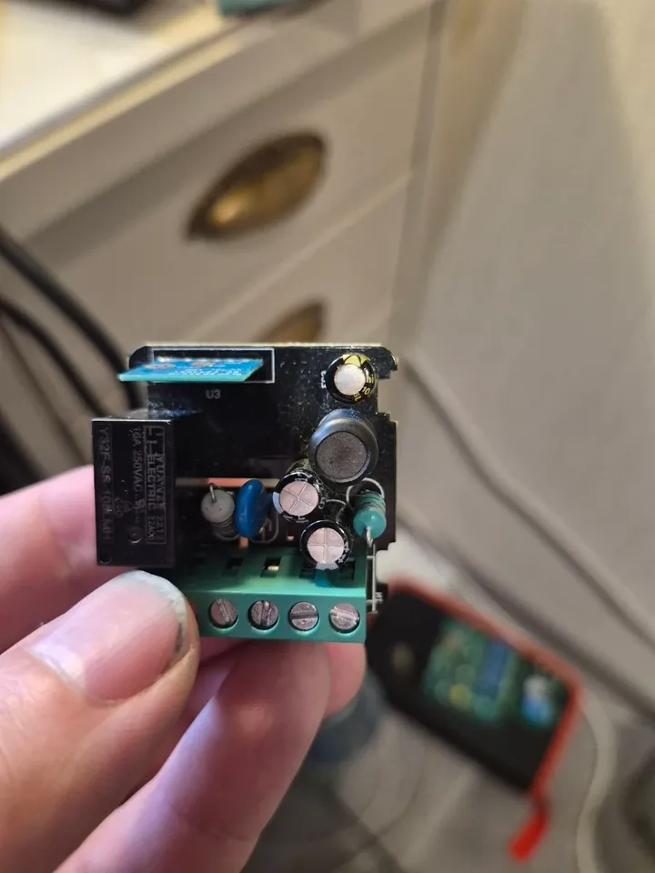
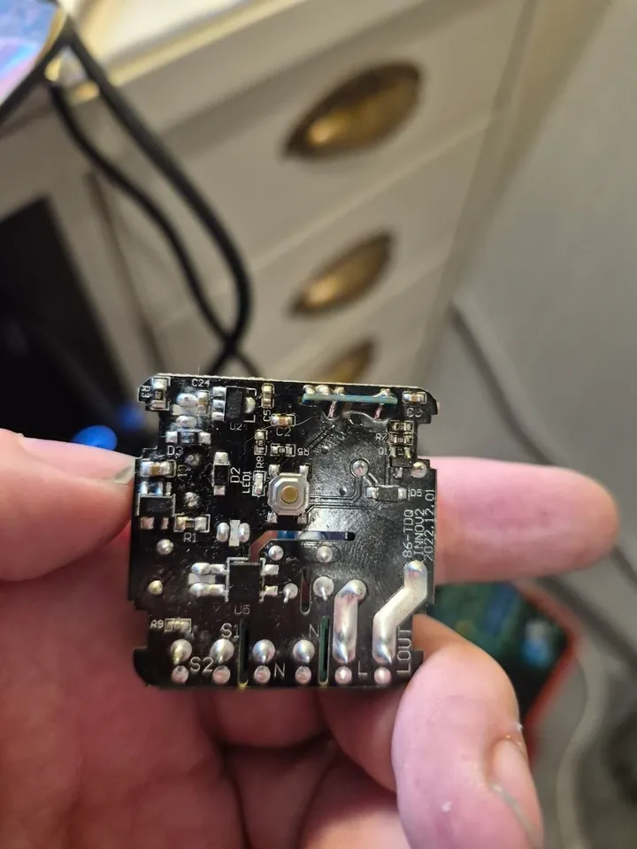

# In-wall relay 86-TDQ (CB2S-type module in a slot, Beken BK7231N) on ESPurna

A no-name in-wall 1-channel relay for AC 100-240 V: board printed **86-TDQ JINNOV2 2022.12.01**, terminals S2 S1 N N L
LOUT, a 16 A relay with a 5 V coil (Y32F-SS-105LMH), a button and a Wi-Fi LED. The Wi-Fi module (BK7231N, the stock
config calls it CB2S) stands upright in the slot U3, front row labelled CEN ADC P8 P7 P6. 2 MiB flash with a Tuya
bootloader of another build than the CB3S / CBU ones (CRC32 `6802f257`, same partitions); the firmware knows it since
2026-11-07. No Matter factory data on the chip: Matter makes its own identity.

<p>
  
  
  
  
</p>

**Safety.** Treat the low-voltage side as not isolated from the mains (as on the other in-wall boards, not measured here). Flash and debug only
with the mains disconnected, from 5 V. Never connect the USB-UART adapter while it is on 230 V.

## Image and pins

`beken-matter`. Pins from the stock config (`user_param_key` of the dump, [bk7231tools](https://github.com/tuya-cloudcutter/bk7231tools) `dissect_dump`):

| Function | Pin | Keys |
|----------|-----|------|
| relay (active high) | P8 | `relayGpio0 8` |
| Wi-Fi LED (active low) | P7 | `ledGpio0 7`, `ledInv0 1` |
| button (active low) | P10 (RX1) | `btnGpio0 10`, `btnMode0 pushbutton`, `btnPinMode0 pull-up`, `btnDefVal0 high`, `btnRelay0 0` |
| wall switch S1 / S2 | P26 | `btnGpio1 26`, `btnMode1 switch`, `btnPinMode1 pull-up`, `btnDefVal1 initial`, `btnRelay1 0`, `btnPress1 relay-toggle`, `btnRlse1 relay-toggle` |

The button sits on P10, the RX pin of UART1: the serial port leaves it to the button by itself and keeps TX (P11) for
the log, no `uartRx0` key needed.

## Flashing

- **Power: 5 V on C3**, the 470 µF / 10 V electrolytic next to the slot (the relay coil rail), its minus is GND. The
  3.3 V pin of a USB-UART adapter is enough to read and write the flash, but not for ESPurna to start Wi-Fi: it stays
  silent until the board gets its 5 V.
- **UART1** on the module pins (TX1 / RX1, GND). **CEN** is the first pin of the front row, there is also a CEN test pad
  on the back of the module; the bootloader caught the link without touching it here.
- **Speed:** writing at the default 115200 failed twice at the same point after about 1 min 50 s (`No response
  received` at 0x100000); at `-b 921600` it took 27 s:

```
ltchiptool flash read -d COM3 -t 60 bk7231n stock.bin
ltchiptool flash write -d COM3 -b 921600 -t 60 espurna-beken-initial-tuya.uf2
```

Then upload `espurna-beken-matter.bin` once over Wi-Fi for the Matter code (the board, already on that build, takes
the Matter code out of it), or let *ADMIN → From GitHub* do both uploads.

## Tested

Backup (2 MiB, stock dump kept locally), UART flash, first boot, Wi-Fi, the bootloader recognized (OTA at 0x12A000),
pins from the stock config, UART RX released to the button, update over Wi-Fi in two uploads (`OK, again`, then the
Matter code), Matter started with its own identity, the relay switches.
