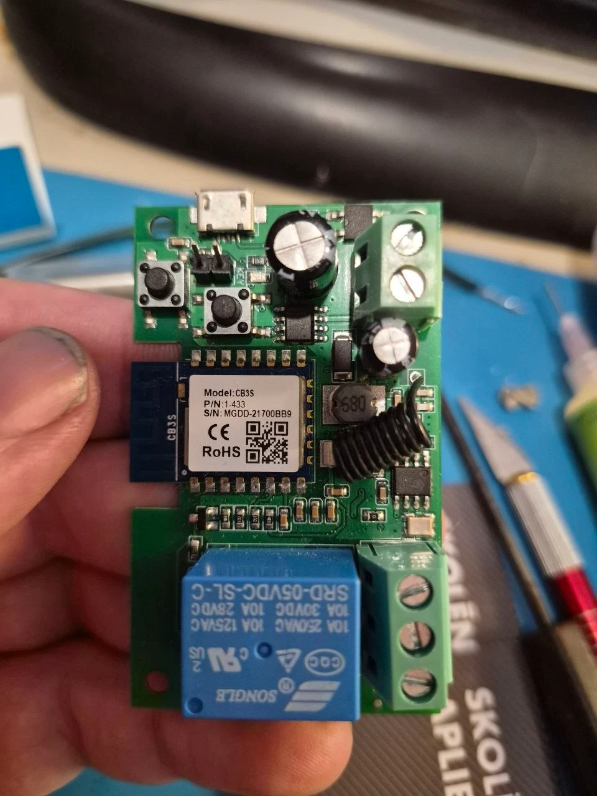
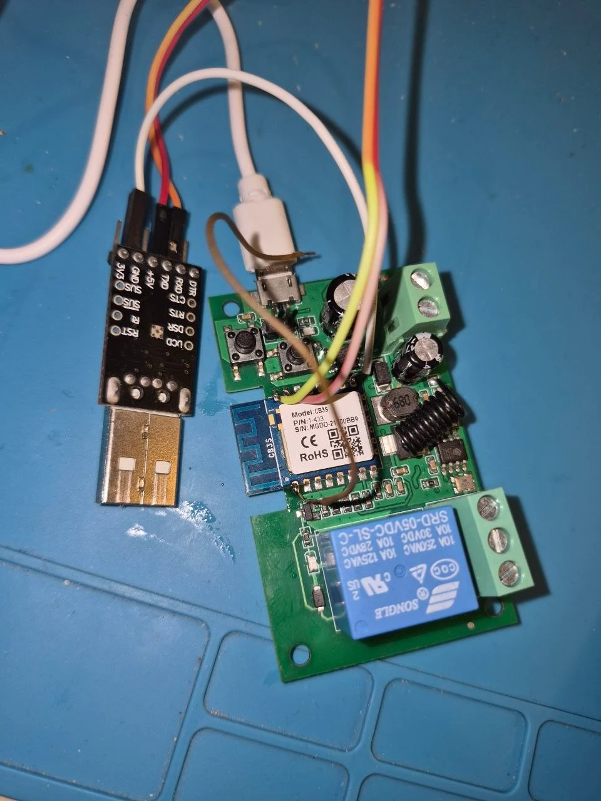
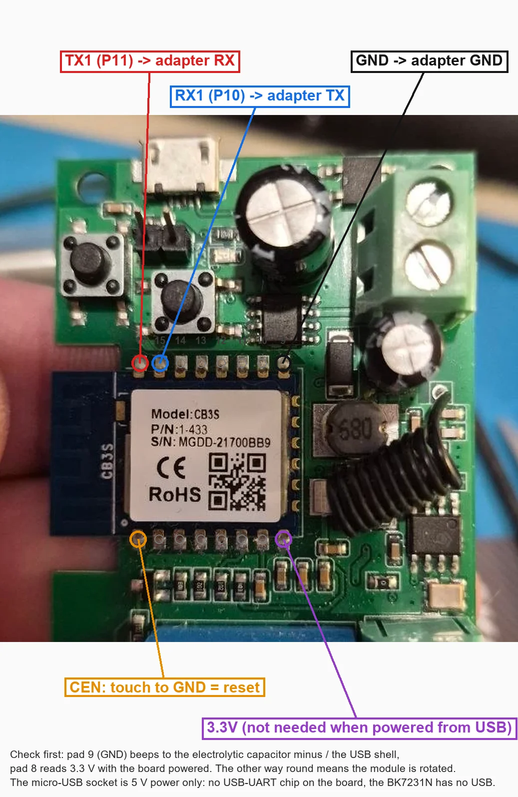
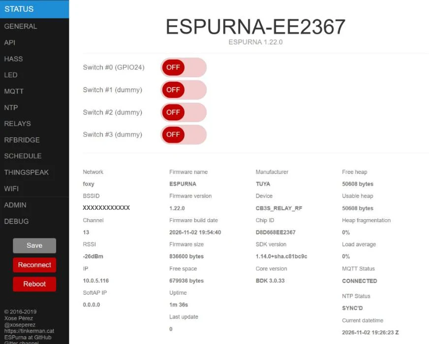
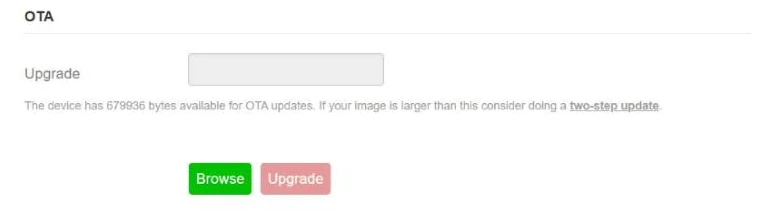
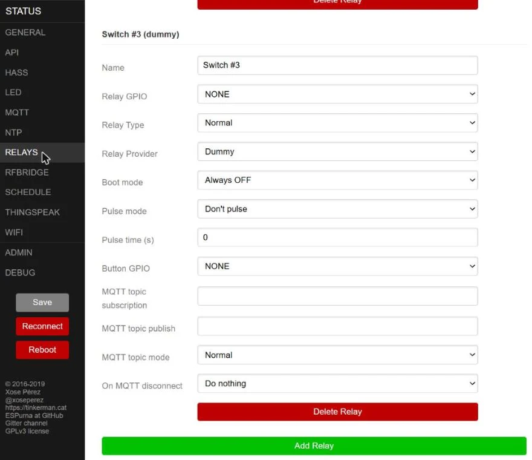
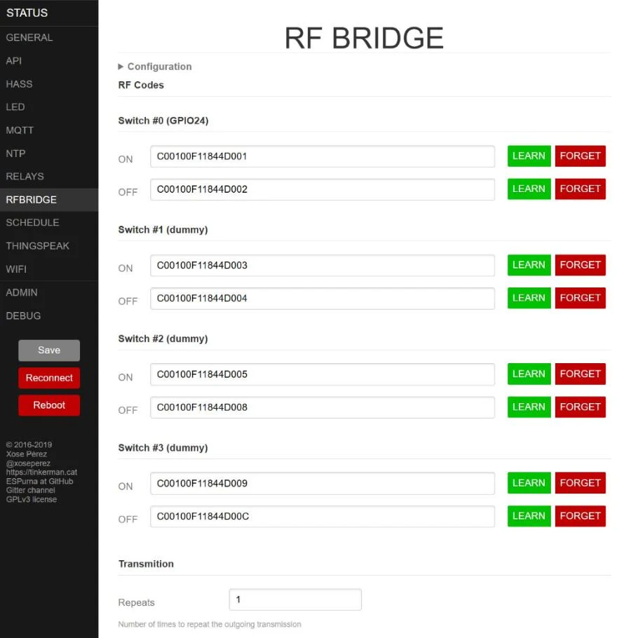

# Tuya CB3S (Beken BK7231N) on ESPurna

ESPurna on Beken BK72xx chips, the ones inside Tuya CB2S / CB3S / WB2S modules that replaced the ESP8266 in most Tuya
devices. The port is built with [LibreTiny](https://docs.libretiny.eu/) (PlatformIO platform `libretiny`, Arduino API on top
of the Beken BDK 3.0.33) and runs next to the ESP8266 and ESP32 builds from the same source. Beken-specific code is under
[`code/espurna/arch/beken`](../code/espurna/arch/beken), the builds are in
[`code/platformio_beken.ini`](../code/platformio_beken.ini).

It was brought up on a Tuya **TYWRA-RF** "Smart Switch": a 1-channel 10 A relay with a 433 MHz receiver, powered by AC/DC
7-32 V or 5 V micro-USB (CB3S module, BK7231N). Tested on that board:
relay, both buttons, LED, the 433 MHz remote, Wi-Fi, web UI (direct and behind a reverse proxy), OTA over Wi-Fi, MQTT, HTTP
API, NTP, serial and telnet terminal, settings kept across reboots and updates.

<p>
  
  
</p>

Other Beken boards, with what differs from this guide:

- [Tuya 4-gang switch module (CBU)](cbu-4gang.md): relay 1 and the LED on the UART1 pins, 5 V needed for flashing;
- [Sparkleiot Mini Smart Switch (XH-CB2S, BK7231M)](sparkleiot-mini.md): no flash encryption and its own 4 MiB layout,
  stock Matter firmware, a second wall switch on a test pad.

## 1. Image

One image, `beken-matter` (build `beken-bk7231n`), for every BK7231N board: every GPIO of the chip, no relays, buttons or
LEDs pre-assigned (device template or web UI). The firmware finds out at boot which bootloader the chip has, from the
CRC32 of its first `0x11000` bytes (Tuya `f684a1dc`, Quectel `64b02979`; `info` in the terminal shows it), and works with
its flash layout. On an unknown bootloader it runs, but writes nothing to the bootloader's partitions: no OTA, no Matter
code. The image is linked for 4 MiB of flash (`code/boards_beken/bk7231n-any.json`), so the partitions of the Quectel
layout are reachable; on a 2 MiB chip only the Tuya ones are used.

| Release file | Build output | What for |
|--------------|--------------|----------|
| `espurna-beken-initial-tuya.uf2` | `firmware.uf2` | first flash over UART, Tuya bootloader (CB1S, CB2S, CB3S, CBU, CB2L ...: 2 MiB, encrypted flash) |
| `espurna-beken-initial-quectel.uf2` | `espurna-beken-quectel.uf2` | first flash over UART, Quectel bootloader without flash encryption (4 MiB), e.g. the XH-CB2S / BK7231M of the [Sparkleiot Mini](sparkleiot-mini.md) |
| `espurna-beken-matter.bin` | `espurna-beken.bin` | every update over Wi-Fi, on both: the board writes the part made for its bootloader |

`espurna-beken-matter.bin` is a container (`ESPBEKEN` header with the build id and a table of parts, made by
[`code/scripts/beken_link_tail.py`](../code/scripts/beken_link_tail.py)): the RBL for the Tuya bootloader (the image
without its Matter code), the RBL for the Quectel bootloader (the whole image) and the Matter code. Each part has a CRC32.
How the WebUI installs it: [section 7](#7-updates-over-wi-fi) and [docs/updates.md](../docs/updates.md#beken-the-browser-uploads-the-board-picks-its-part).

Enabled modules: web UI, API, MQTT, terminal, Home Assistant, Alexa, Domoticz, Thingspeak, scheduler, the RF bridge
(rc-switch, unused until `rfbRX` is set) and Matter (off until `matterAuto 1` or MATTER.START). ESPurna's own mDNS
responder is off in this image: the Matter stack answers mDNS itself. The Tuya TYWRA-RF has no build of its own:
`beken-matter` with the *Tuya TYWRA-RF* device template. The firmware version carries the git revision
(`1.22.0-git<sha>`, `scripts/beken_version.py`), the WebUI release list finds the running release by it.

**Matter.** One On/Off plug per relay, up to 4. With one relay it is a plain plug on endpoint 1; with more the device is a
gateway: an Aggregator on endpoint 2 and a bridged plug per relay on endpoints 3 to 6, named after the relay (`relayName`,
else `<hostname> <n>`). Up to 3 controllers (fabrics). Fabrics live in FlashDB on the `kvs` partition (`0x1D3000`), which
updates do not touch, so a board stays paired across updates; `MATTER.RESET` forgets them and keeps the identity. The
MATTER page shows the setup codes, the controllers and an *Open pairing window* button (the window closes after 15
minutes, or once a controller added the device). While a controller commissions, MQTT disconnects and Alexa pauses for
up to 5 minutes (quiet mode, the certificate checks need the heap); the web UI stays connected.

Matter on the 2 MiB Tuya layout: the Matter code does not fit next to the rest of the image (the app partition is
1124 KiB, ESPurna with Matter about 1.4 MiB), it lives in a region of the 664 KiB `download` partition of its own. So the
same file goes up twice: the first upload brings the image (the bootloader installs it as usual, the form answers
"OK, again"), the second one, after the reboot, the Matter code. On the Quectel layout one upload does both.
`MATTER.TAIL` in the terminal tells whether the Matter code is there and matches the image; the MATTER page says it too
and has *Install the Matter code*. While Matter runs, a firmware upload is refused once (HTTP 409) with a reboot without
Matter: upload again after it. Boards with Quectel Matter factory data (`0x3E0000`) use it: the certificates and the
setup code printed on the box. Boards without make their own identity at the first start (development DAC, VID 0xFFF1 /
PID 0x8000, random setup code): controllers that accept SDK example devices, such as the speaker hub and
python-matter-server, accept it.

The Matter library (`libMatterApp.a`, connectedhomeip 1.5 for the BK7231N) is not built here: `custom_matter_lib = latest`
takes the newest `libmatter-*` release of [igorufox/matter-bk7231n](https://github.com/igorufox/matter-bk7231n) (built by
its GitHub Actions with the gcc 10.3.1 of LibreTiny) and checks it against the `.sha256` asset of that release, ref.
[`code/scripts/beken_matter_lib.py`](../code/scripts/beken_matter_lib.py) and [docs/updates.md](../docs/updates.md#beken-matter-library).

Static data of ESPurna and of the Matter library lives in the data TCM of the chip (about 37 KiB more heap), see `heap`
in the terminal and the TCM row on the status page.

Pin numbers are GPIO numbers (`P24` is GPIO 24, set it as `24` in the web UI). Only the pins that the module brings out
can be used.

## 2. What you need

- a USB-UART adapter with 3.3 V logic (CP2102, CH340, FT232; the photo shows a CP2102);
- four wires soldered to the module pads, or three if you can reach CEN with a wire end by hand;
- [ltchiptool](https://github.com/libretiny-eu/ltchiptool) for the first flash. It comes with the LibreTiny platform
  (`%USERPROFILE%\.platformio\penv\.libretiny\Scripts\ltchiptool.exe` after the first build) or `pip install ltchiptool`;
- optional: [bk7231tools](https://github.com/tuya-cloudcutter/bk7231tools) to read the stock pin map out of the backup.

The flashing is done once. After that every update goes over Wi-Fi.

## 3. Wiring



| CB3S pad | Connect to |
|----------|------------|
| 16, TX1 (P11) | adapter RX |
| 15, RX1 (P10) | adapter TX |
| 9, GND | adapter GND |
| 1, CEN | a loose wire: touch it to GND to reset the chip |

- **Power the board from its micro-USB socket** while flashing. This socket is 5 V power only: the board has no USB-UART
  chip, and the BK7231N has no USB. The terminal block takes AC/DC 7-32 V (the relay coil itself is 5 V). Leave the adapter's 3.3 V unconnected then. Without USB power, feed pad 8 (3.3 V) from a 3.3 V supply
  strong enough for Wi-Fi; the 3.3 V pin of most adapters is not.
- Check the pads with a meter before you solder. Pad 9 (GND) beeps to the minus of the electrolytic capacitor and to the USB
  shell, pad 8 reads 3.3 V with the board powered. If it is the other way round, the module is rotated.
- The full CB3S pad order. Top row from the antenna end: 16 TX1 (P11), 15 RX1 (P10), 14 P7, 13 P8, 12 P21, 11 TX2 (P0),
  10 P9, 9 GND. Bottom row: 1 CEN, 2 P23 (ADC), 3 EN, 4 P14, 5 P26, 6 P24, 7 P6, 8 3.3 V.
- CEN does not need to stay connected. The chip enters its bootloader for a short moment after every reset, and ltchiptool
  catches it there. Touch CEN to GND briefly while ltchiptool shows `Connecting...`. Unplugging and plugging the USB power
  does the same.
- UART1 (P10 / P11) is also where the firmware logs, at 115200 baud, so the same wires give you the boot log and the
  terminal later.

## 4. Back up the stock firmware

Do this first. It is the only way back to the Tuya firmware, and it holds the pin map of the board.

```
ltchiptool flash read -d COM3 -t 45 bk7231n cb3s-stock.bin
```

`-d` is the adapter's port (COM3, `/dev/ttyUSB0`), `-t 45` waits 45 s for the chip; touch CEN to GND when it says
`Connecting...`. A full dump is 2 MB.

On a board that is not in the table above, read the pin map out of the dump:

```
bk7231tools dissect_dump -e --storage cb3s-stock.bin
```

`user_param_key.json` in the output lists the pins. `rl1_pin` is relay 1, `bt1_pin` is button 1, `netled1_pin` is the
Wi-Fi LED, `remote_io` is the 433 MHz receiver. The `_lv` fields give the active level (`1` = active high).

## 5. Flash ESPurna

Take `espurna-beken-initial-tuya.uf2` (or `-initial-quectel.uf2`, see the table above) from the
[release](https://github.com/igorufox/espurna/releases/latest), or build it from `code/`:

```
py -3 -m platformio run -c platformio_beken.ini -e beken-bk7231n
```

The image for the Tuya bootloader is `code/.pio/build_beken/beken-bk7231n/firmware.uf2`, for the Quectel one
`espurna-beken-quectel.uf2` in the same folder. The build uses its own build directory, so it does not touch
the ESP8266 / ESP32 builds in `.pio/build`. Then flash it:

```
ltchiptool flash write -d COM3 -t 45 code/.pio/build_beken/beken-bk7231n/firmware.uf2
```

Touch CEN to GND at `Connecting...` again. The chip starts ESPurna by itself at the end, no reset is needed. After the first
setup below, pick the board on *ADMIN → Device Template* (`tywra` finds the TYWRA-RF) and reboot.

Only the `app` partition (`0x11000`) is written. The Tuya bootloader and the Tuya config at `0x1EE000` stay where they were,
so the stock pin map is still on the chip.

The Tuya UART image has no Matter code (it does not fit the app partition). Before Matter can start, upload
`espurna-beken-matter.bin` of the same release once over Wi-Fi: the board, already running that build, takes only the
Matter code out of it. *Install the Matter code* on the MATTER page does the same. The Quectel UART image has it.

**A board that already runs ESPurna needs no CEN wire.** The bootloader answers the link check of ltchiptool for a short
moment after every reboot, and the ESPurna terminal is on the same UART1 at 115200: send `reset` on the port right before
ltchiptool starts linking, and the chip is caught at its restart. That takes a small wrapper around ltchiptool which
writes `reset` to the port just before the link check (not in the repository); with the plain ltchiptool reset the chip by
CEN or by its power as above.

## 6. First setup

1. Join the Wi-Fi network `ESPURNA-XXXXXX` (the last six digits of the MAC) with the password `fibonacci`.
2. Open `http://192.168.4.1`, log in as `admin` / `fibonacci` and set a new password when asked.
3. Add your network on the **Wi-Fi** tab, then reach the device at the address your router gives it.

A phone should show the "sign in to network" page by itself (captive portal, not checked on a phone yet); otherwise
open the address by hand.
There is no `ESPURNA-XXXXXX.local` name: ESPurna's mDNS responder is off in the Matter image, use the IP address.

Buttons of the TYWRA-RF (ESPurna defaults):

| Button | Click | Double click | Long click | Very long click |
|--------|-------|--------------|------------|-----------------|
| P14 | toggle the relay | start the access point | reboot | factory reset |
| P6 | toggle the relay | - | - | - |



The status page after setup: the real relay on GPIO 24 and three dummy relays, the Beken BDK as the core version,
about 50 KB of free heap. There is no VCC row, the module has no supply voltage measurement.

## 7. Updates over Wi-Fi

**From GitHub.** *ADMIN*, OTA, *From GitHub*, *Show releases*, *Install*: the browser downloads `espurna-beken-matter.bin`
of the release (from GitHub Pages: the board itself cannot download from GitHub, its mbedTLS has no ECDHE) and uploads
it; the WebUI lists the steps ahead and goes through them by itself:

- Quectel bootloader: one upload, the board restarts into the new firmware.
- Tuya bootloader: the upload, the board restarts without Matter code, the same file once more for the Matter code, a
  restart.
- Tuya bootloader with Matter running: one more upload and restart first, Matter cannot run while its code is replaced.

Up to seven steps and three restarts. Keep the board powered until the last step; when an install stops half-way the
board keeps its firmware (at worst without Matter) and *Install* can be started again.

**By hand.** Upload `espurna-beken-matter.bin` on **ADMIN → Upgrade**. It takes about 30 s, plus about 20 s while the
bootloader installs it, and keeps the settings. On the Tuya bootloader upload the same file once more when the form says
"OK, again" (the Matter code, see above), and once more first when it answers that Matter is running. A plain LibreTiny
`.uf2` is still accepted when it was built for the bootloader of the board. Either way the board writes only the part of
the file made for its bootloader, and the first bytes of it last: an interrupted upload leaves nothing for the
bootloader to install.



If the upload stops halfway (Wi-Fi drop, closed tab), the board keeps running the old firmware. Start the upload again.

## 8. The 433 MHz remote

The receiver on P26 is decoded by the chip itself (rc-switch). Every code it hears goes to MQTT `<root>/rfin` and to the
debug log, so you can use the remote buttons in Home Assistant or Node-RED without binding them on the board.

To switch relays from the remote:

1. Make as many relays as you need: one per remote button pair, or one per button. **Add Relay** at the end of the
   **Relays** tab, with the provider **Dummy**, gives a relay with no GPIO: it only has a state, which goes to MQTT and the
   API like any relay. 32 relays in total is the limit. From the terminal, `set relayDummy <N>` and a `reset` add N such
   relays after the ones with a GPIO.

   

2. On the **RFBRIDGE** tab every relay has an ON and an OFF row. Press **LEARN** in a row and then the remote button within a few
   seconds. The same code in both rows makes that button toggle the relay.
3. Or type the code into the field and press **Save**. The format is the one `<root>/rfin` and the debug log show:
   `C0`, protocol, pulse length (2 bytes), number of bits, then the code, all in hex. `C00100F11844D001` is protocol 1,
   241 µs, 24 bit, code `44D001`. The pulse length is not compared, so any value matches.
4. From the terminal: `rfb.learn <relay> <on|off>`, `rfb.forget <relay> [on|off]`, or `set rfbON<relay> <code>` /
   `set rfbOFF<relay> <code>`.



With four relays, an 8-button remote fits exactly: ON and OFF of each relay on its own button, as above. With more remote buttons,
add more relays; every new relay gets its own ON / OFF rows here.

Tested with an 8-button remote (protocol 1, 24 bit): 16 out of 16 presses received. About one press in 16 comes out as
protocol 17 (a looser sync pulse) with the same bits; codes are matched by bit count and payload only, so it still
switches the relay.

## 9. How this build differs from the stock LibreTiny settings

- **BLE off** (`CFG_SUPPORT_BLE = 0`). With BLE on, the SDK links the whole BLE 5.1 stack, and the OTA image no longer fits
  the 664 KiB `download` partition.
- **PMF and WPA3 off** (`CFG_IEEE80211W = 0`, `CFG_WPA3 = 0`). With them on, the SDK supplicant failed the handshake
  (`AUTH_FAIL`) on OpenWrt access points with WPA2-PSK, 802.11r and optional PMF (`ieee80211w=1`). WPA2 networks work as
  before.
- **AsyncTCP task stack 2560 words** (`CONFIG_ASYNC_TCP_STACK_SIZE`, 10 KiB). FreeRTOS here counts the stack in words, not
  in bytes as on the ESP32. The library default meant 64 KiB and left 6 KiB of heap, and clients of the access point could
  not connect. Every option is set once in `[beken-common]`: PlatformIO puts `-U` after every `-D`, so `-UX -DX=1` leaves
  `X` undefined.
- **Static data in the TCM** (`custom_tcm_bss`, [`scripts/beken_tcm.py`](../code/scripts/beken_tcm.py)): the `.bss` of
  ESPurna and of the Matter library goes into the 60 KiB data TCM, which only the Wi-Fi driver uses with BLE off.
- **Thread-safe function-local statics** ([`cxa_guard_beken.cpp`](../code/espurna/arch/beken/cxa_guard_beken.cpp)).
  LibreTiny's libstdc++ has no threads: two tasks touching the same static for the first time trapped with "undefined
  instruction"; the second one now waits.
- **Logs on UART1** (`LT_UART_DEFAULT_PORT=1`): LibreTiny, the SDK and ESPurna all print on the flashing pads.
- **Patched AsyncTCP** ([`code/lib_beken/AsyncTCP-espurna`](../code/lib_beken/AsyncTCP-espurna)), used instead of the
  registry version. A dropped connection could leave the web server using a freed lwIP connection, and other requests then
  stalled for 10 to 40 s.
- **Captive portal DNS** ([`code/lib_beken/DNSServer`](../code/lib_beken/DNSServer), copied from arduino-esp32). The SDK DHCP
  server runs its own DNS stub on port 53 that refuses every query, so clients of the access point decided there was no
  internet and never showed the sign-in page. Ours is bound to `192.168.4.1` and gets the queries first.
- **Access point on the router's channel.** There is one radio: with STA connected the access point uses its channel, on the
  configured `wifiApChan` the two kept switching the radio and STA dropped every few seconds.
- **Crash handlers** (`-Wl,--wrap=bk_trap_*`, [`rtcmem_beken.cpp`](../code/espurna/arch/beken/rtcmem_beken.cpp)). The SDK ones
  overwrite the retention register, so the stability counter was lost on every crash and a crash loop never put the
  device into the unstable mode. Ours keep it and add the exception type ("Crash (data abort)" etc. in `info`).
- **Crash record** at `0x1EB000`, the flash sector between the settings slots and the Tuya config. The handlers write the
  registers (r0-r12, sp, lr, pc, cpsr, spsr), 32 words of the stack, the task, the uptime and the build into it. The next
  boot reports a new record once: `[MAIN] Last crash: undefined instruction pc=0x... lr=0x... task=...` in the log and the
  same line on MQTT `<root>/crash`; the `CRASH` terminal command prints the whole record. Look the addresses up in the ELF
  of the same build: `arm-none-eabi-addr2line -f -C -e code/.pio/build_beken/<build>/raw_firmware.elf <pc> <lr>`
  (the CI release keeps the ELF too). Without a wire this is the only trace of a crash, RAM does not survive the reset.
- **Random numbers** come from the chip's TRNG. LibreTiny's `lt_rand_bytes()` is the libc `rand()`, which nothing seeds,
  so it gave every board the same numbers; `srand()` is now seeded from the TRNG at boot.
- **Settings** are kept in 8 rotating slots in the `userdata` partition at `0x1DB000`, below the Tuya config. Every slot has
  a CRC, and the newest valid slot is loaded at boot.

## 10. Known limitations

- No RAM survives a reset on the BK7231N (the bootloader clears all of it). The custom reset reason ("Reboot from a
  terminal command", "after a successful OTA update") and the stability counter are carried in the 16-bit SDK retention
  register instead, so they survive reboots done by ESPurna and crashes; after a hang only `watchdog` is known.
  Relay states are restored from the settings, not from RTC memory.
- ESPurna's mDNS responder is off in the Matter image (the Matter stack answers mDNS for itself), so `<hostname>.local`
  is not announced; looking up the MQTT broker over mDNS (`mqttServer` left empty) does not work either, set the broker
  address.
- `wifiTxPwr` (dBm) works, but the SDK calibration caps it: 10 dBm measured about 5 dB below the default 20 dBm.
- No ArduinoOTA, and the board does not download updates itself: the browser brings the file (see section 7).
- `GPIO`, `GPIO.MODE`, `GPIO.LOCKS`, `REG.READ`, `REG.WRITE` terminal commands read the BK72xx GPIO registers directly,
  `FUNCTION` marks a pin taken by a peripheral (UART, PWM).
- The ADC (P23) is not used, and there is no VCC measurement, so the VCC row is hidden on the status page.
