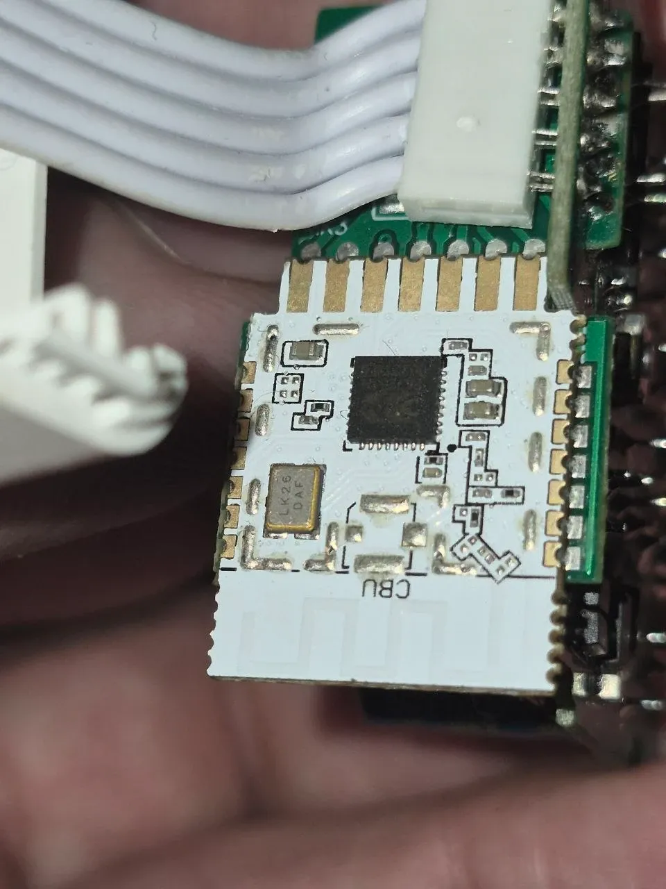
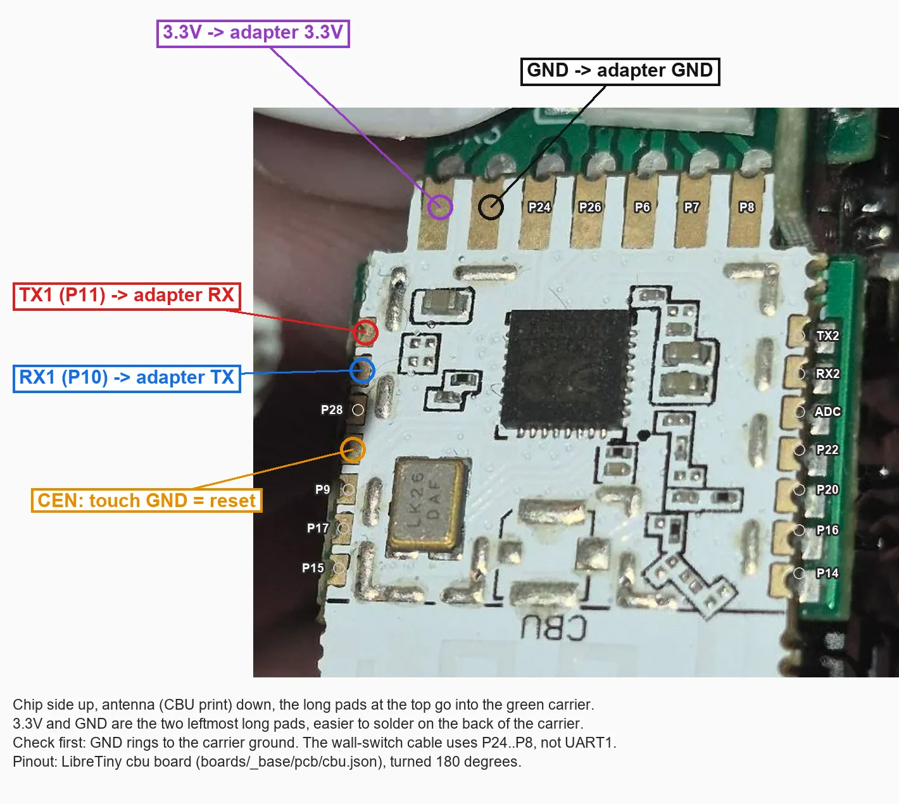

# Tuya 4-gang switch module (CBU, Beken BK7231N) on ESPurna

An in-wall 4-gang switch: four relays, four wall-switch inputs on a 5-wire cable, a "total" button and a Wi-Fi LED. The
Wi-Fi part is a bare (unshielded) Tuya **CBU** module (BK7231N, 2 MB flash, standard Tuya flash layout and keys) soldered
upright into a small green carrier. Flashing, backup and OTA work as on every Tuya module, see [README.md](README.md); this page only
lists what differs.

<p>
  
  
</p>

## Build

`beken-matter`, the image of every BK7231N board (it maps all GPIOs, P9, P15, P17 and P28 included):
`espurna-beken-initial-tuya.uf2` of the [release](https://github.com/igorufox/espurna/releases/latest) for the first flash,
`espurna-beken-matter.bin` for updates. Or built from `code/`:

```
py -3 -m platformio run -c platformio_beken.ini -e beken-bk7231n
```

## Wiring

With the chip side up and the antenna (CBU print) down:

| Edge | Pads |
|------|------|
| left, top to bottom | **TX1 (P11)**, **RX1 (P10)**, P28, **CEN**, P9, P17, P15 |
| top (long pads in the carrier), left to right | **3.3V**, **GND**, P24, P26, P6, P7, P8 |
| right, top to bottom | TX2, RX2, ADC, P22, P20, P16, P14 |

The pinout is LibreTiny's `cbu` board (`boards/_base/pcb/cbu.json`) turned by 180 degrees; it matches the labels on the back
of the module. The white cable to the wall switches starts at the GPIO edge, it is not the serial port.

- **Power from the 5 V rail, not from the adapter's 3.3 V.** The stock firmware switches the 5 V relays while you try to reset
  it into the bootloader, and the 3.3 V pin of a USB-UART adapter collapses. Feed 5 V where the relay coils get it; the 3.3 V
  regulator of the board then supplies the module.
- CEN works as on the CB3S: touch it to GND at `Connecting...`.

## Pins

From the stock Tuya config (`user_param_key` in the backup, see the CB3S guide):

| Function | Pin | Stock key |
|----------|-----|-----------|
| relays 1-4 (active high) | P10, P24, P26, P28 | `rl1_pin` ... `rl4_pin` |
| wall switches 1-4 (toggle type) | P6, P7, P8, P9 | `onoff1` ... `onoff4` |
| "total" button (active low) | P23 | `total_bt_pin` |
| Wi-Fi LED (active high) | P11 | `netled1_pin` |

**Relay 1 sits on RX1 and the LED on TX1**, the same pins as the serial port. Turn the UART off, or the serial terminal owns
P10 / P11 and relay 1 never switches. Wire flashing still works afterwards, the ROM bootloader does not care.

```
set uartTx0 153
set uartRx0 153
set relayGpio0 10
set relayGpio1 24
set relayGpio2 26
set relayGpio3 28
set btnGpio0 6
set btnMode0 switch
set btnPinMode0 pull-up
set btnDefVal0 initial
set btnPress0 relay-toggle
set btnRlse0 relay-toggle
set btnRelay0 0
(the same for btn1 .. btn3 on P7, P8, P9 with btnRelay 1 .. 3)
set btnGpio4 23
set btnMode4 pushbutton
set btnPinMode4 pull-up
set btnDefVal4 high
set btnRelay4 0
set ledGpio0 11
set ledInv0 0
set ledMode0 wifi
reset
```

After that the board is reached over Wi-Fi only: web UI, telnet, MQTT. The same set is the *Tuya 4-gang switch module*
entry of the [own device list](../README.md#picking-the-board) (*ADMIN → Device Template*).

## Tested

Backup, flash, first boot, access point, joining the home network, MQTT, the four relays and the wall-switch inputs with
the pins above. ESPurna crashed once ("undefined instruction") about 10 s after the very first boot and ran without a reset
after that.
