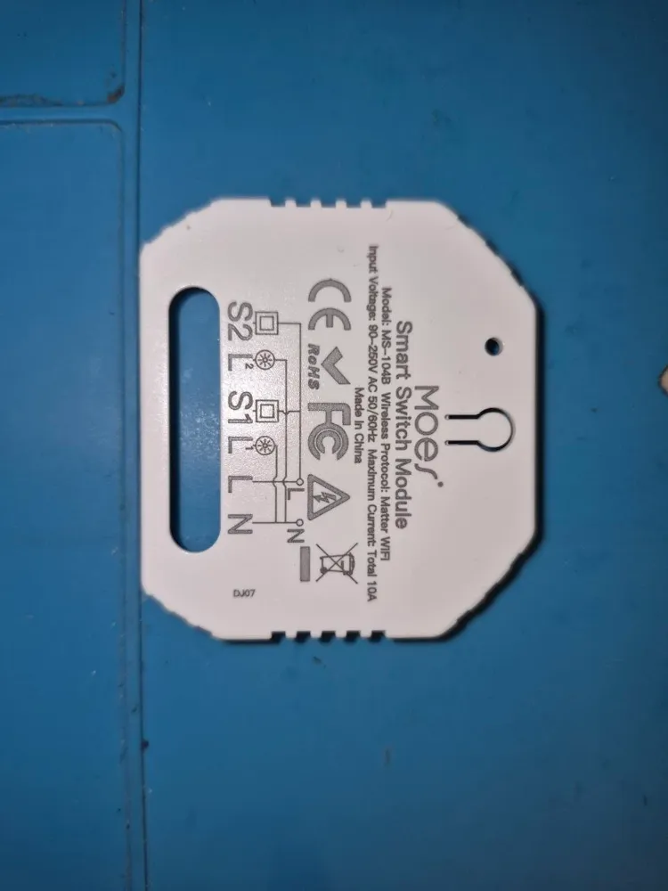
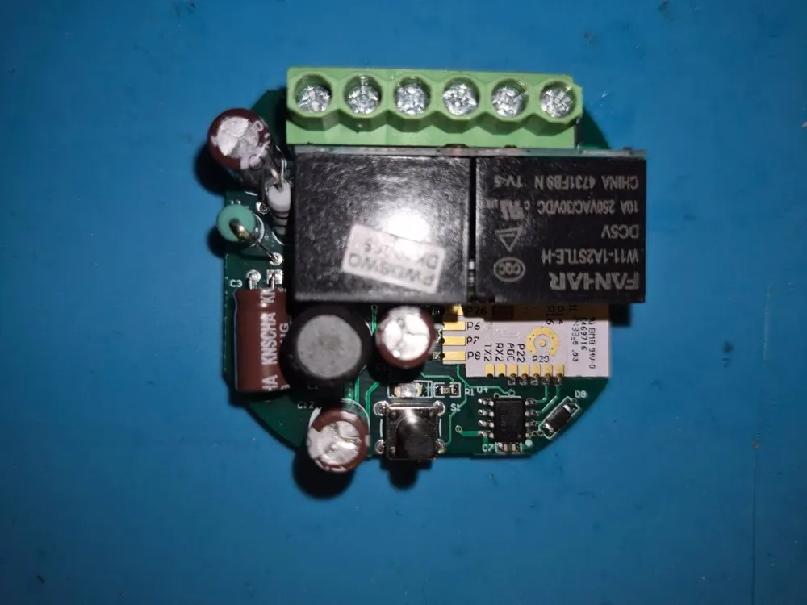
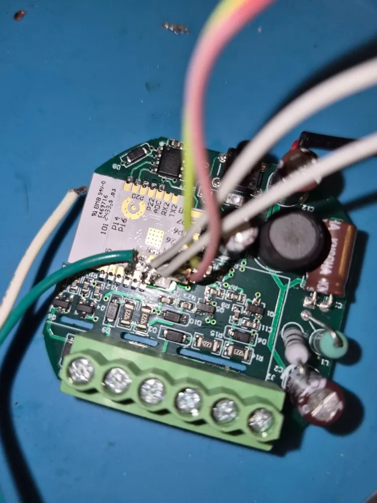
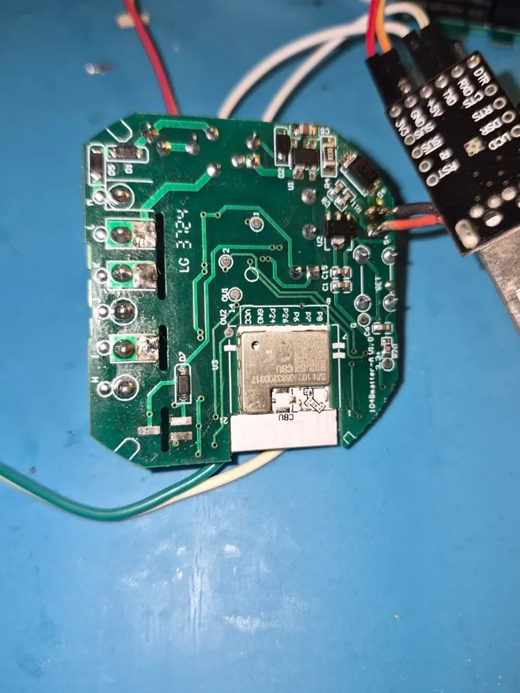
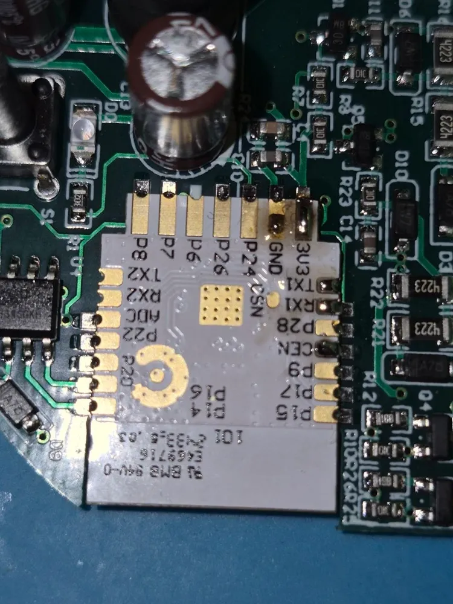
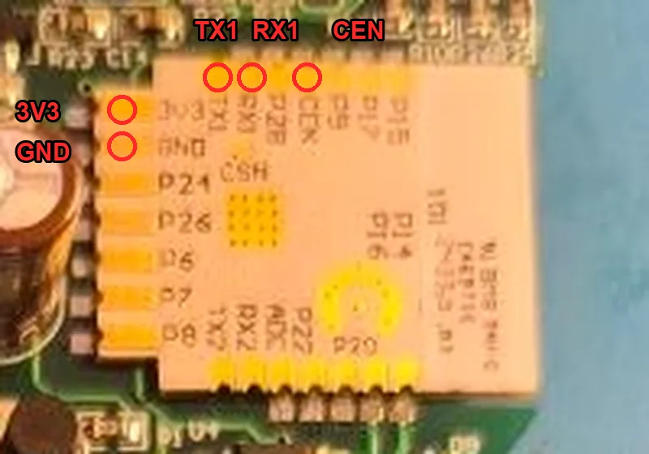
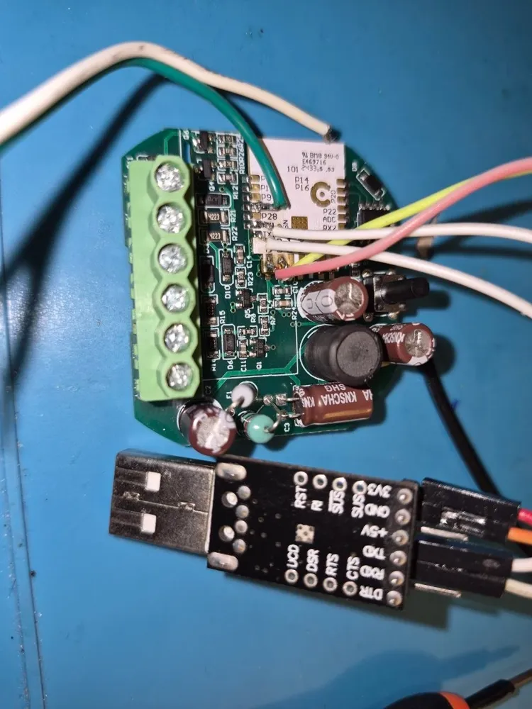
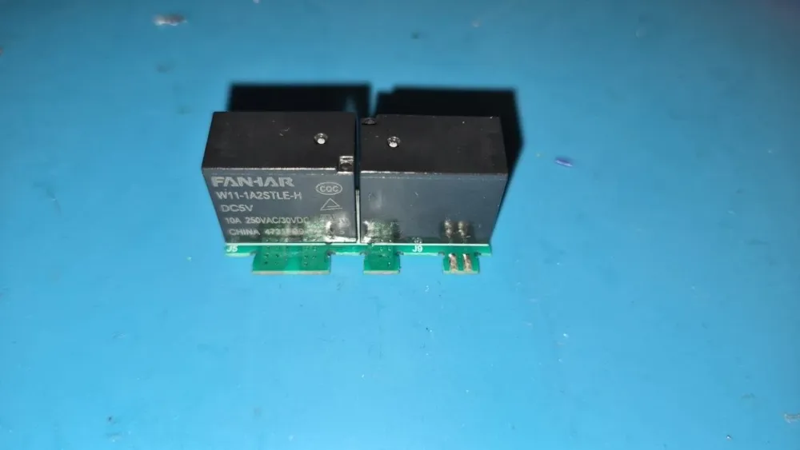
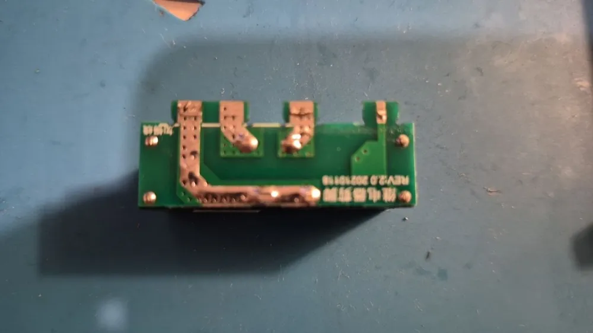

# MOES MS-104B Matter (CBU, Beken BK7231N) on ESPurna

**Short version: not worth it.** It works (two relays, the MOES Matter identity, the speaker hub), but getting there took
a whole evening: the CBU module sits under the relay block, which has to be desoldered to reach it; the board cannot
be powered for flashing in any way that just works; and it comes with Tuya's bootloader 3.00 that does not take our
updates and has to be replaced over UART. Buy another board for ESPurna; flash this one only if it is already on the
bench.

MOES "Smart Switch Module" **MS-104B**, 2 channels, 90-250 V AC, 10 A total, "Wireless Protocol: Matter WiFi" on the
label (Tuya model FNHDM20003, Matter VID `0x147D` PID `0x084E`, "MOES Matter Switch"). **Same model name as the
[MS-104B on ESP8266](../esp8266/moes-ms-104b.md), a different board**: this one is larger, has a Beken CBU module
(BK7231N, 2 MiB flash) and Tuya's Matter firmware. A round main board (marked `104Matter`) with the 6-way terminal
block, the power supply, a button and the CBU on its back; the two relays (FANHAR W11-1A2STLE-H, 5 V coil, 10 A) sit on
a daughterboard (REV2.0) over it.

  
  
  

  
  
  
  

  
  

## Image and pins

`beken-matter`, after the bootloader is replaced (below). Pins from the stock config, the button checked on the board:

| Function | Pin | Keys |
|----------|-----|------|
| relay 1 (active high) | P8 | `relayGpio0 8` |
| relay 2 (active high) | P7 | `relayGpio1 7` |
| wall switch input S1 (230 V) | P14 | `btnGpio0 14`, `btnMode0 pushbutton`, `btnPinMode0 pull-up`, `btnDefVal0 high`, `btnRelay0 0` |
| wall switch input S2 (230 V) | P16 | `btnGpio1 16`, `btnMode1 pushbutton`, `btnPinMode1 pull-up`, `btnDefVal1 high`, `btnRelay1 1` |
| button on the board (S1 on the silkscreen, "total" button of the stock firmware) | P10 (RX1) | `btnGpio2 10`, `btnMode2 pushbutton`, `btnPinMode2 pull-up`, `btnDefVal2 high`, `btnRelay2 0` |
| Wi-Fi LED (inverted) | P24 | `ledGpio0 24`, `ledInv0 1` |

The button on the board toggles relay 1 here (the stock firmware switched both; ESPurna has no "all relays" action). It
sits on RX1: the serial port leaves the pin to the button, the log stays on TX1. The S1 / S2 inputs are not tested
(mains): their mode may need `switch` instead of `pushbutton` once a wall switch is wired.

The same as a device template in the [ESPurna devices list](https://github.com/igorufox/espurna-devices).

## What is on the chip

| Flash | What |
|-------|------|
| `0x000000` | Tuya bootloader **3.00** (CRC32 of `0x0`-`0x11000` = `39afde9f`; bk7231tools does not know it, CRC `0x3D27F00A`) |
| `0x011000` | the application |
| `0x1E1000` | bootloader 3.00: update "manage" sector (diff2ya) |
| `0x1E3000` | RF calibration (`TLV` block). The LibreTiny layout has it at `0x1D0000` |
| `0x1F5000` | Tuya key-value store, encrypted: Wi-Fi and the **Matter factory identity** (DAC and its key, PAI, certification declaration, passcode, discriminator) |

The flash encryption key in eFuse is the standard Tuya one (the eFuse bytes are the Tuya coefficients word-swapped).

**Matter factory identity.** ESPurna reads it out of the Tuya key-value store (`MATTER.FACTORY` in the terminal), so the
board keeps its MOES VID / PID, certificates and the QR code on its sticker. The certification declaration names the
device type On/Off Light (`0x0100`): the relay endpoints get that type instead of On/Off Plug-in Unit, otherwise the speaker hub, which knows the product by its VID / PID, never gets past the first step. `set matterTuya 0` makes the board use
its own identity instead (the factory data stays on the chip).

**RF calibration.** The stock firmware keeps it at `0x1E3000`. Without it the radio runs on defaults and is too weak
for even the access point to be seen. ESPurna copies the block to `0x1D0000` on its first boot (log line
`RF calibration block copied`); this has to happen before the settings are saved a few times, their slots cover
`0x1E3000`. Tested by writing the stock state back over UART: copied on the next boot, factory MAC, -25 dBm. More in
[RF calibration and MAC](README.md#rf-calibration-and-mac).

## Bootloader 3.00

Tuya's bootloader of its Matter firmware does not take an RBL image in the download partition. It takes **diff2ya**
packages: a 64-byte header (magic `0x4D4D4D`, type `LZCP` = whole image compressed with XZ, or a bspatch patch from the
running image) placed anywhere in flash, and a "manage" sector at `0x1E1000` (magic `0xABCDDCBA`, byte-sum checksum)
with the package's address and size. The format is the one of the T1 / BK7238 Tuya bootloader, implemented in
ltchiptool (`soc/bk72xx/util/diff2ya.py`). Tested on this board: a package of our image written over UART to `0x12A000`
plus the manage sector was installed by the bootloader, which encrypts and adds the CRCs itself. It installs in 64 KiB
steps and continues after a reset; leave the board alone for a few minutes after writing the manage sector.

ESPurna does not make such packages: on this bootloader a firmware update over Wi-Fi is refused (`info` shows
`Tuya bootloader 3.00, no firmware OTA`), the Matter code can still be uploaded over Wi-Fi. **Replace the bootloader**
with the standard Tuya one instead (CRC32 `f684a1dc`, the first `0x11000` bytes of a stock dump of another Tuya BK7231N
board such as the CB3S or CBU ones on these pages). That is safe on the BK7231N: the UART flashing protocol is in the
chip's ROM, a broken bootloader is rewritten over UART. One write from `0x0` (bootloader + `image_bk7231n_app.0x011000.crc`
of the build, padded to 4 KiB) does both, then the board updates over Wi-Fi like the other Tuya boards.

## Flashing

**Access.** The CBU is under the relay block: it has to be desoldered (the relays here are), and the board cannot be
switched on the bench afterwards.

**Power.** Nothing worked reliably; the adapter, the 5 V and the CEN wire all feed and reset the chip in their own way.
What worked in the end (2026-11-07):

1. board on 5 V only (the adapter's 3.3 V not connected), catch the link with CEN: the link is there, but the write
   dies with `Write timeout`;
2. leave the board on 5 V (the chip stays in download mode), pull the USB-UART adapter out of the USB port, connect its
   3.3 V wire, plug it back: the COM port is clean and there is extra 3.3 V;
3. the second attempt writes.

Other findings:

- **CEN** sags the supply: touching it to GND often kills the COM port. Do not tie CEN to 3.3 V and short it, use a
  100 Ω - 1 kΩ resistor to GND for the reset.
- With ESPurna running there is no need for CEN at all: send `reset` to its terminal on UART1 right before the flasher
  starts linking (the chip answers link checks for a moment after every boot).
- Pulling the USB-UART adapter out of the USB port and plugging it back is a reset as well (it removes the adapter's
  3.3 V and the supply through TX / RX); there are about 2 seconds to start the flasher.
- ltchiptool needs to be told the bootloader is the standard BK7231N one (`BkBootloaderType.get_by_crc` patched for
  CRC `0x3D27F00A`), or it fails probing the protocol.
- With 3.3 V from the adapter only the chip reads and writes, but ESPurna starts without Wi-Fi.

## Matter with a smart speaker hub

Added with the QR code of the sticker (MOES identity). If the app hangs at step 1 after an attempt that went half way:
the station keeps the half-added device and keeps opening sessions to it (`CASE failed to match destination ID`, several
per second, in the Matter log). Remove its fabric on the board (`MATTER` lists the controllers, `MATTER.REMOVE <#>`),
switch the station off and on, add again.

## Tested

Backup (2 MiB, stock dump and eFuse kept locally), Tuya key-value store decrypted, bootloader 3.00 diff2ya install,
bootloader replaced, UART flash, RF calibration copied from `0x1E3000` on the first boot, Wi-Fi, pins from the stock config, update over Wi-Fi
in two uploads (firmware, then the Matter code), Matter with the MOES identity and On/Off Light endpoints in the speaker hub. Not tested: the relays switching mains, and the S1 / S2 wall-switch inputs, which take 230 V like on the
ESP8266 MS-104B (the input modes above come from the stock config, not from a test).
