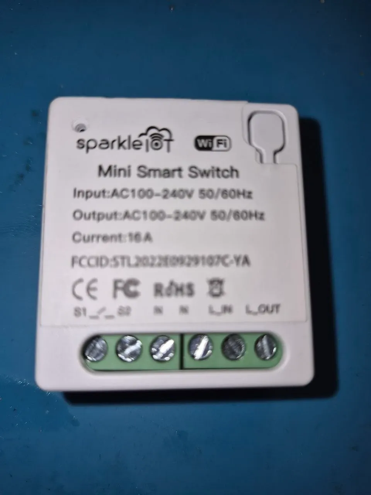
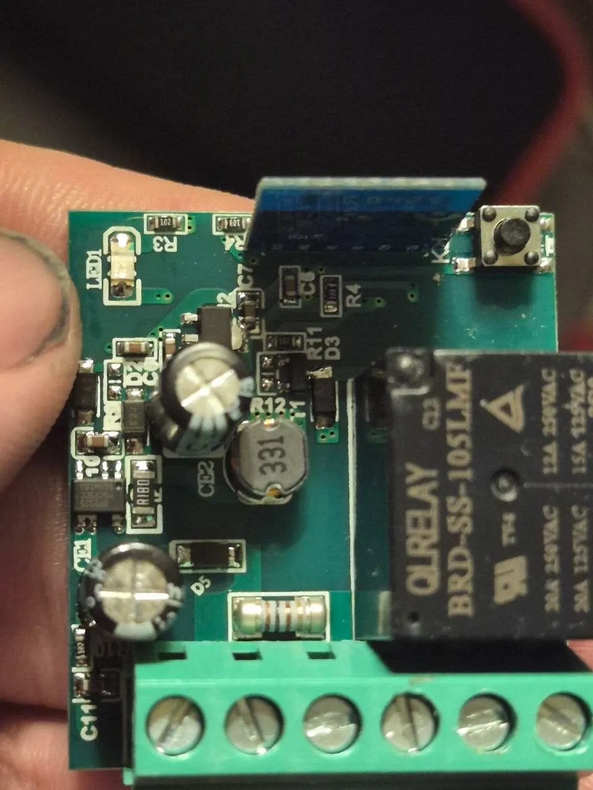
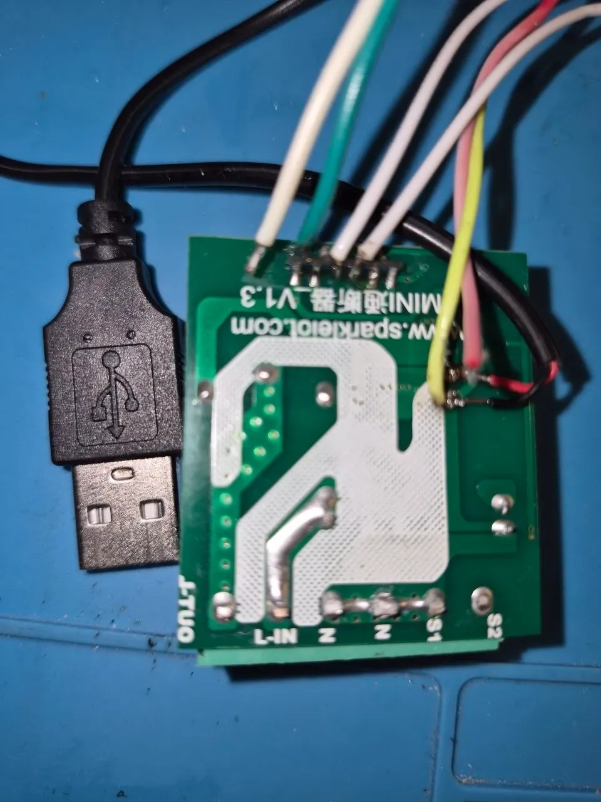
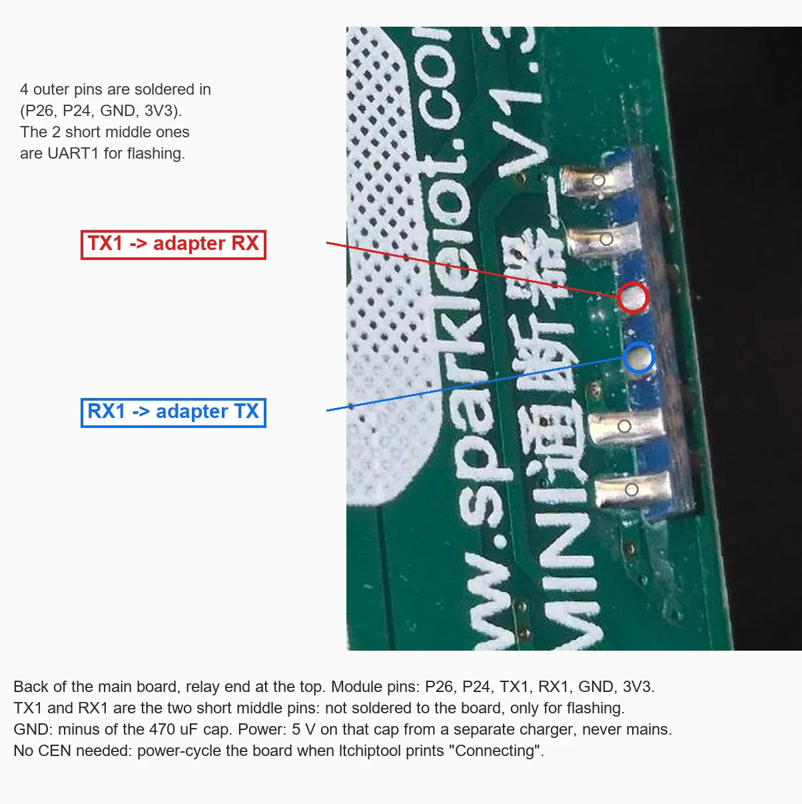
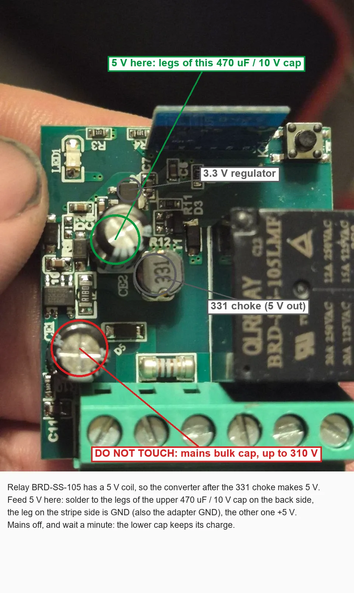

# Sparkleiot Mini Smart Switch (XH-CB2S, Beken BK7231M) on ESPurna

An in-wall 1-channel relay for AC 100-240 V, 16 A, with an S1 / S2 wall-switch input and a button (FCC ID
`STL2022E0929107C-YA`, board "MINI 通断器 V1.3", sparkleiot.com). The stock firmware is a Quectel **Matter** firmware. The
Wi-Fi module is an **XH-CB2S** (a CB2S-sized clone) with a chip marked **BK7231M**. ltchiptool talks to it as a BK7231N, but
it is not a Tuya chip: the flash is **not encrypted** (the eFuse key is all zeros) and the bootloader has its own 4 MiB layout.
The Tuya image does not start on it, it needs the `xh-cb2s-generic` build.

<p>
  
  
  
</p>

**Safety.** S1 is tied to N on the board and the low-voltage side is not isolated from the mains. Flash and debug only with
the mains disconnected, from 5 V. Never connect the USB-UART adapter while it is on 230 V.

## Build

From `code/`:

```
py -3 -m platformio run -c platformio_beken.ini -e xh-cb2s-generic
```

`xh-cb2s-generic` is the CBU pin map (all BK7231N pins) plus
[`code/boards_beken/xh-cb2s-bk7231m.json`](../code/boards_beken/xh-cb2s-bk7231m.json): encryption coefficients `0`, app
partition `0x11000` + `0x1A9000`, OTA (`download`) partition at `0x286000`, 4 MiB flash. These come from the partition
table in the stock bootloader.

## Wiring

The module sits upright in a slot of the main board. It has two rows of contacts on the same edge:

| Row | Pins, relay end first | On the main board |
|-----|-----------------------|-------------------|
| back | P26, P24, **TX1**, **RX1**, GND, 3V3 | all soldered except TX1 / RX1 |
| front | **CEN**, ADC, P8, P7, P6 | soldered |

The back-row labels are printed on the module. CEN was found on the board: the front-row pin at the relay end, the green
wire on the photo of the wired board above, on the other face of the module from TX1 / RX1. The rest of the front row is the
order of another module of the same form factor and was not checked pin by pin.


<p>
  
  
</p>

- **UART:** TX1 to the adapter RX, RX1 to the adapter TX. They are the two short middle pins of the back row, not connected to
  the main board.
- **Power: 5 V on the 470 µF / 10 V capacitor** next to the 331 choke (the output of the mains converter; the relay is a
  BRD-SS-105 with a 5 V coil). The leg on the stripe side is GND, take the adapter GND from there too. Do not touch the large
  capacitor at the terminals, it is the mains one.
- **Take the 5 V from a separate USB charger, not from the adapter.** When the board is powered up from the adapter's 5 V
  the CP2102 resets and the COM port disappears in the middle of the transfer. Keep the charger plugged in a wall socket and
  power-cycle by pulling the charger, with the GND wires left connected.
- **Reset:** solder a wire to CEN (front row, relay end) and touch it to GND when ltchiptool prints `Connecting...`, or
  power-cycle the board once at that moment. Power-cycle only once: a second cycle in the middle of a read leaves ltchiptool
  with `No response received` until it gives up.
- The bootloader logs on UART2, which is not brought out. ESPurna and LibreTiny log on UART1 as usual.

## Back up the stock firmware

```
ltchiptool flash read -d COM3 -t 120 bk7231n xh-cb2s-stock.bin
```

A full dump is 4 MiB and takes 6-8 minutes. Two units of this switch had the same bootloader and app byte for byte; only
the littlefs and the Matter factory data differ. **Keep it private**: the Matter factory data at `0x3E0000` holds the
device's attestation certificate and its private key (DAC), the setup PIN and the discriminator. With this dump the switch
can go back to the stock Matter firmware; the same data must not be copied to another device.

| Region | Content |
|--------|---------|
| `0x000000` | bootloader (plain, Beken rt-ota with its partition table) |
| `0x011000` | app, about 1.2 MiB used, plain (Matter, Quectel SDK) |
| `0x220000` | littlefs: app state, timers, config md5 |
| `0x286000` | OTA download partition (empty) |
| `0x3E0000` | Matter factory data (secret) |

The stock pin map is a binary `product_config.bin` parsed by the Quectel firmware, it is not readable in the dump. The pins
below were found by testing.

## Flash ESPurna

```
ltchiptool flash write -d COM3 -t 120 code/.pio/build_beken/xh-cb2s-generic/firmware.uf2
```

On this board the last piece of the UF2, the 102-byte RBL header at `0x1B9F9A`, failed with `Writing failed; wrote only 0
bytes`. Write the last 4 KiB sector of the app image instead, it carries the same header:

```
ltchiptool flash write -d COM3 -t 120 -f bk7231n -s 0x1B9000 -S 0x1A8000 -l 0x1000 code/.pio/build_beken/xh-cb2s-generic/image_bk7231n_app.0x011000.rbl
```

After a write the chip stays in its download mode: power-cycle the board to start ESPurna. The first start from a weak
5 V supply may reset a few times (`Reset reason: Power-On`) when the access point comes up, then it runs.

Only the app is written. The bootloader, the littlefs and the Matter factory data stay on the chip.

**MAC address.** The SDK reads the MAC from the RF calibration block, and this board has none (a Tuya module has it at
`0x1D0000`). Every such switch would come up as `C8:47:8C:42:00:48`, and two of them on one network share one IP. On the
first boot ESPurna writes a small block of its own into the empty calibration sector with a locally administered
`CA:47:8C:xx:xx:xx` (`No RF calibration block, MAC ... written to a new one` in the log). From then on the address, the
chip ID and the `ESPURNA-XXXXXX` name stay the same across reboots, updates and factory resets. Nothing is written if the
sector is not empty. The three random bytes come from the chip's TRNG. The first build took them from an unseeded `rand()`
and gave every board `CA:47:8C:2D:F4:51`; a board that still has that one in its own block gets a new address on the
next boot (`MAC of the first build was the same on every board, ... written instead`), so expect a new IP once.

## Pins

Found by testing on the board:

| Function | Pin | ESPurna |
|----------|-----|---------|
| relay (active high) | P24 | `relayGpio0 24` |
| button K1 (active low) | P7 | pushbutton, pull-up |
| S1 / S2 wall-switch input | P26 | switch mode, pull-up (S2 closed to S1 = N) |
| LED (active low) | P6 | `ledInv0 1`, Wi-Fi status |
| not connected to anything on the board | P8, P23 | |

A **second wall switch** fits on **P21**, a round test pad on the back of the module that the main board does not use:
P21 → 1-4.7 kΩ resistor at the module → mains-rated wire → switch → S1. Here it toggles a dummy relay (an MQTT-synced lamp
elsewhere) or the board's own relay.


```
set relayGpio0 24
set relayDummy 1
set btnGpio0 7
set btnMode0 pushbutton
set btnPinMode0 pull-up
set btnDefVal0 high
set btnRelay0 0
set btnGpio1 26
set btnMode1 switch
set btnPinMode1 pull-up
set btnDefVal1 initial
set btnPress1 relay-toggle
set btnRlse1 relay-toggle
set btnRelay1 1
set btnGpio2 21
set btnMode2 switch
set btnPinMode2 pull-up
set btnDefVal2 initial
set btnPress2 relay-toggle
set btnRlse2 relay-toggle
set btnRelay2 0
set ledGpio0 6
set ledInv0 1
set ledMode0 wifi
set sysManufacturer SPARKLEIOT
set sysDevice MINI_XH_CB2S
reset
```

Swap `btnRelay1` / `btnRelay2` if the wall-switch wires are the other way round. The same set is the *Sparkleiot Mini*
entry of the [own device list](../README.md#picking-the-board) (*ADMIN → Device Template*).

## Tested

Backup, flash, boot, access point, home Wi-Fi, MQTT, the relay, K1, S1 / S2, the LED and the second switch on P21, on the
desk from 5 V; two units.

**OTA over Wi-Fi works**: `firmware.uf2` uploaded on *ADMIN → Upgrade* (32 s), the stock bootloader copies it from the
`download` partition at `0x286000` into the app and the board is back after about 30 s with `Reboot after a successful OTA
update` and the new build date. Settings, the MAC and the IP stay. Only the first flash has to go over the wires.
