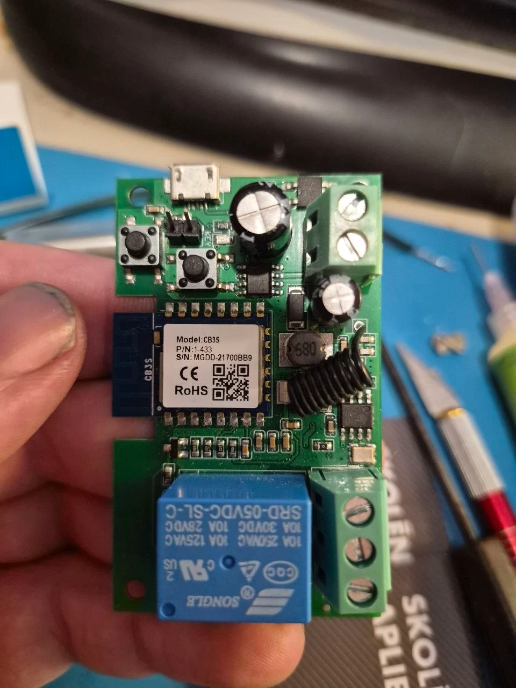
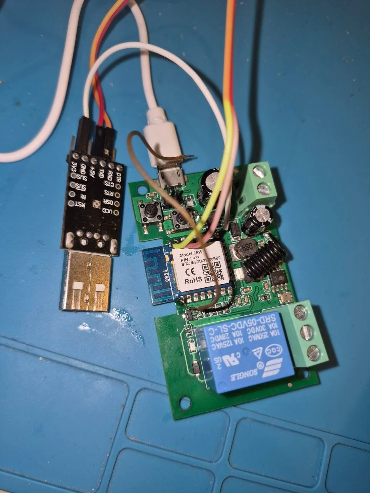
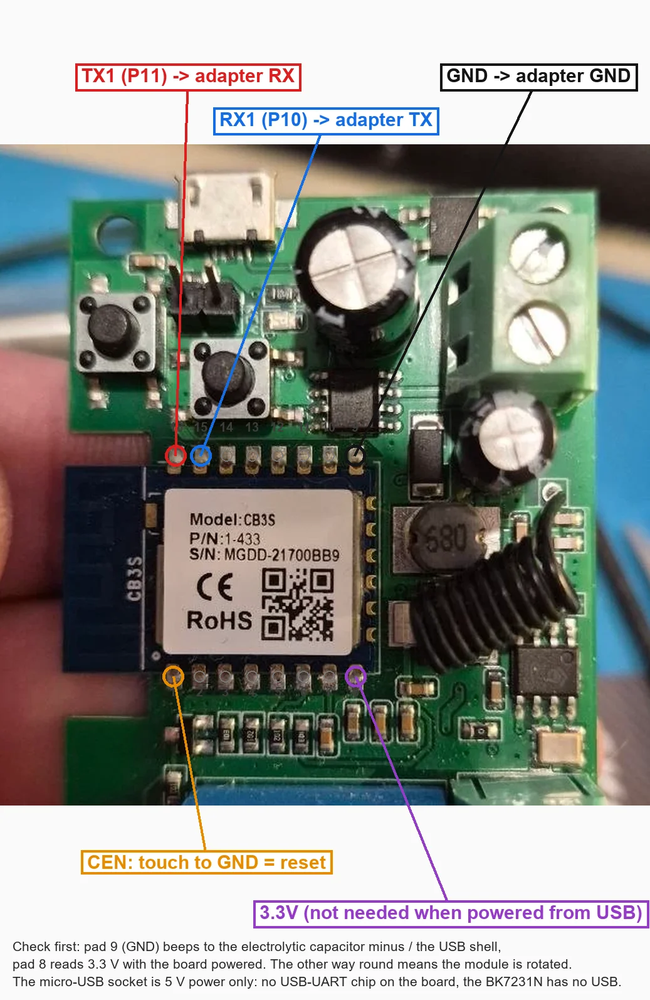
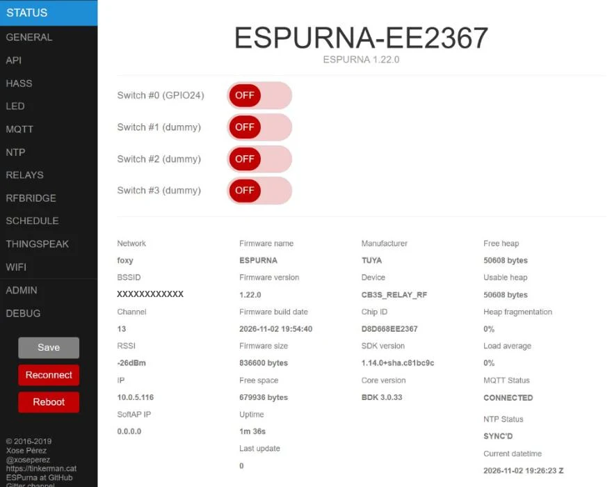

# Tuya TYWRA-RF Smart Switch (CB3S, Beken BK7231N) on ESPurna

A 1-channel 10 A relay with a 433 MHz receiver, powered by AC/DC 7-32 V or 5 V micro-USB. The Wi-Fi part is a Tuya
**CB3S** module (BK7231N, 2 MiB flash, Tuya bootloader, encrypted flash). The Beken port was brought up on this board.
General steps (image, first flash, setup, updates, Matter) are in [README.md](README.md); this page has what is specific
to the board.

  
  

## Image

`beken-matter`, the image of every BK7231N board, with the *Tuya TYWRA-RF* device template (*ADMIN → Device Template*,
`tywra` finds it): relay P24, buttons P14 and P6, LED P8 (inverse), 433 MHz receiver P26. First flash:
`espurna-beken-initial-tuya.uf2`; updates: `espurna-beken-matter.bin` (on this 2 MiB layout the Matter code goes up with
a second upload of the same file, the WebUI does it by itself).

## Wiring

| CB3S pad | Connect to |
|----------|------------|
| 16, TX1 (P11) | adapter RX |
| 15, RX1 (P10) | adapter TX |
| 9, GND | adapter GND |
| 1, CEN | a loose wire: touch it to GND to reset the chip |

- **Power the board from its micro-USB socket** while flashing. This socket is 5 V power only: the board has no USB-UART
  chip, and the BK7231N has no USB. The terminal block takes AC/DC 7-32 V (the relay coil itself is 5 V). Leave the
  adapter's 3.3 V unconnected then. Without USB power, feed pad 8 (3.3 V) from a 3.3 V supply strong enough for Wi-Fi;
  the 3.3 V pin of most adapters is not.
- Check the pads with a meter before you solder. Pad 9 (GND) beeps to the minus of the electrolytic capacitor and to the
  USB shell, pad 8 reads 3.3 V with the board powered. If it is the other way round, the module is rotated.
- The full CB3S pad order. Top row from the antenna end: 16 TX1 (P11), 15 RX1 (P10), 14 P7, 13 P8, 12 P21, 11 TX2 (P0),
  10 P9, 9 GND. Bottom row: 1 CEN, 2 P23 (ADC), 3 EN, 4 P14, 5 P26, 6 P24, 7 P6, 8 3.3 V.

Backup and flashing commands: [README.md](README.md#4-first-flash-over-uart) (a full dump of this board is 2 MiB).

## Buttons

ESPurna defaults with the template:

| Button | Click | Double click | Long click | Very long click |
|--------|-------|--------------|------------|-----------------|
| P14 | toggle the relay | start the access point | reboot | factory reset |
| P6 | toggle the relay | - | - | - |

## The 433 MHz remote

The receiver sits on P26 (`rfbRX 26`, set by the template). Learning remote buttons to relays:
[README.md](README.md#7-433-mhz-receiver). Tested with an 8-button remote (protocol 1, 24 bit): 16 out of 16 presses
received.

The status page of this board with three dummy relays for the remote next to the real one on GPIO 24. There is no VCC
row, the module has no supply voltage measurement.

## Tested

Relay, both buttons, LED, the 433 MHz remote, Wi-Fi, web UI (direct and behind a reverse proxy), MQTT, HTTP API, NTP,
serial and telnet terminal, settings kept across reboots and updates. Matter with two controllers (the speaker hub and
python-matter-server). Updates from the WebUI release list, all three uploads of the 2 MiB layout, including the one
refused while Matter runs. Twice the network went deaf on the boot right after the Matter code was written; the
[network watchdog](README.md#8-known-limitations) restarted the board after about 2.5 minutes both times.
