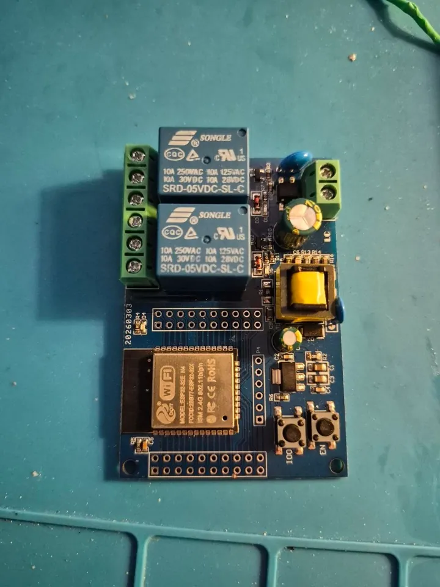
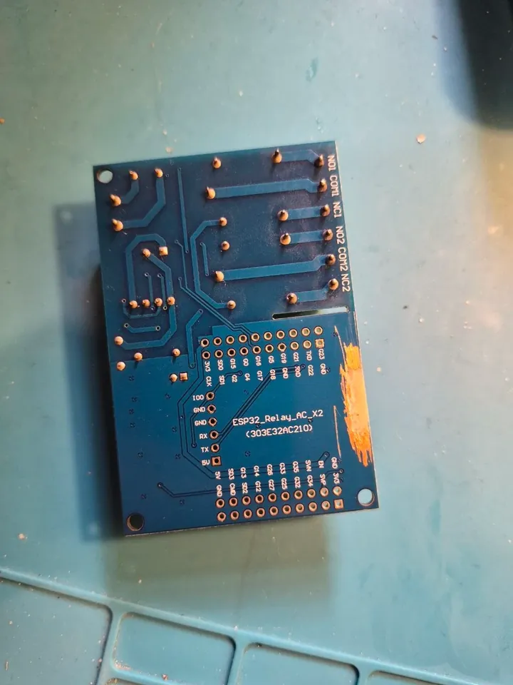
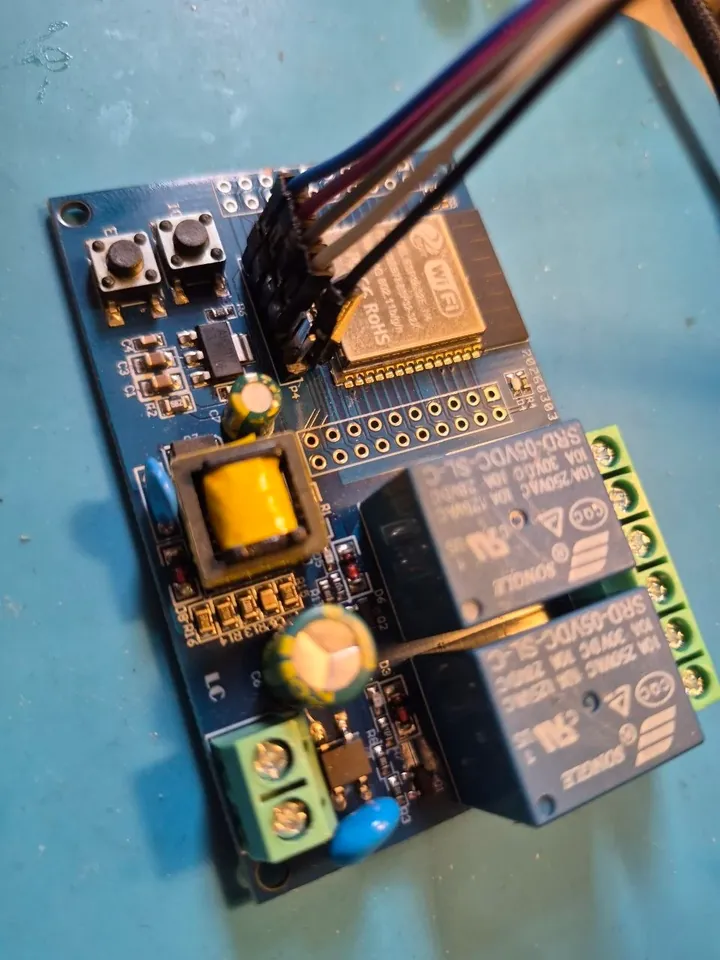

# LC-Tech ESP32 relay x2 on ESPurna

A 2-relay board, printed **ESP32_Relay_AC_X2 (303E32AC210)**: mains powered (its own AC/DC converter, 2-pin input
terminal), two 10 A relays with NO / COM / NC terminals, an ESP32-32E module (ESP32-D0WD-V3, 4 MB flash), buttons IO0 and
EN, every GPIO on two pin rows, and a 6-pin header P4 for flashing: IO0, GND, GND, RX, TX, 5V. There are also DC-powered
variants of the same layout ([ESP32_Relay_X2](https://templates.blakadder.com/ESP32_Relay_X2.html) in Tasmota Device
Templates).

<p>
  
  
</p>

**Flashing** goes over the P4 header (RX / TX to the adapter, GND); hold IO0 while pressing EN to enter the ROM
bootloader. P4 also has 5V; powering the board from it instead of mains was not tried here.



## Image and pins

`esp32-matter`. The board had an image of its own before; the generic one takes the pins from the settings. Set them
before an update from such an image (they match its built-in values, nothing changes on the running board), or after the
first boot, from the terminal of the WebUI (*DEBUG*):

```
set relayGpio0 16; set relayGpio1 17; set btnGpio0 0; set btnMode0 pushbutton; set btnDefVal0 high; set btnPinMode0 pull-up; set btnRelay0 0; set ledGpio0 23; set ledInv0 1; set sysManufacturer LC_TECH; set sysDevice ESP32_RELAY_X2
```

| Function | GPIO |
|----------|------|
| relay 1 | 16 |
| relay 2 | 17 |
| button | 0 |
| LED (inverse) | 23 |

## The lab board

- **Matter**: two plugs (one per relay, a gateway with bridged plugs), in the speaker hub and python-matter-server at the
  same time.
- **Layout migration over Wi-Fi**: from the old two-slot layout (`min_spiffs`) to the safeboot layout through the web
  `/safeboot` migration, NVS kept. Before that a migrator that touched the web server too early boot-looped it, and a wire
  was needed once.
- **Update from the WebUI**: *From GitHub* → the release's safeboot (when it differs) → restart into the safeboot →
  download of the `-ota.bin` → ESPurna, 54 s, Matter fabrics kept.

## Tested

Both relays, the button, the LED, Matter with two controllers, the safeboot update from GitHub, the two-slot migration.
