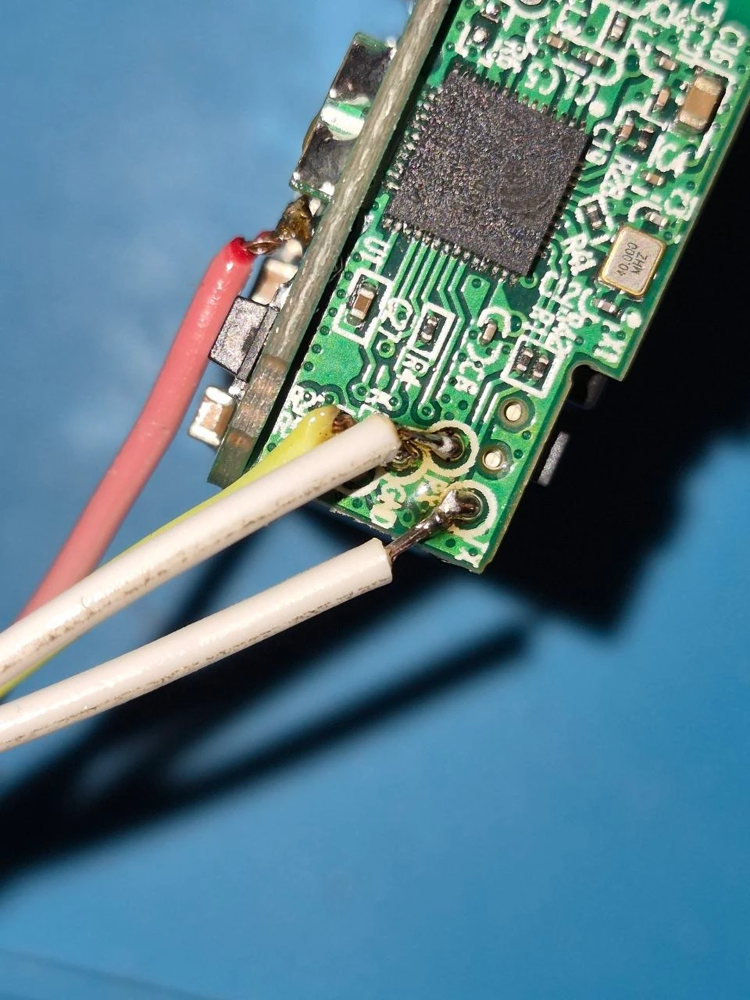
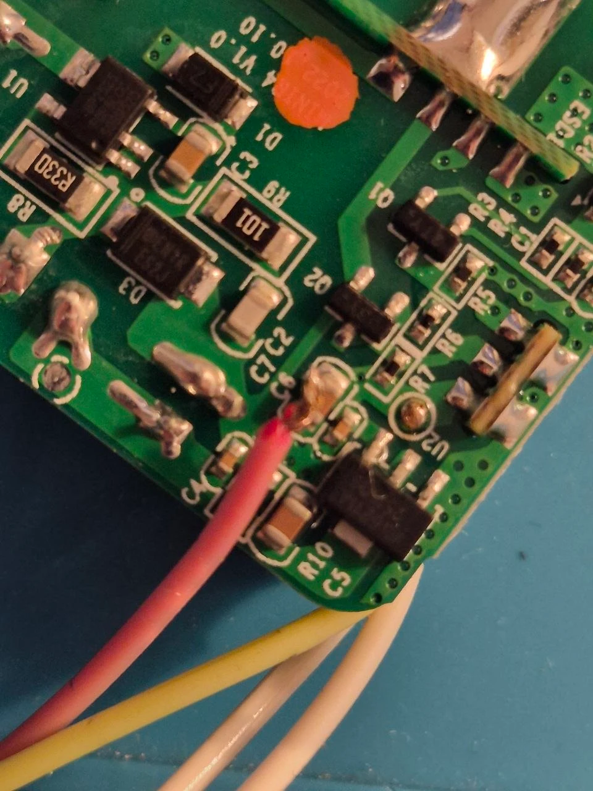

# Sonoff MINIR4 "Mini Extreme" (ESP32) on ESPurna

An in-wall 1-channel relay with an S1 / S2 wall-switch input. ESP32 on a small vertical daughter board, 4 MB flash. Stock
eWeLink firmware `FWSW-E32R4-MINIR4` (no Matter in it; the Matter model MINIR4M is an ESP32-C3 board that this build
does not cover).

|||
|---|---|
|||
|serial wires on the ESP32 daughter board|3V3 at the U2 pad, bottom of the main board|

## Image and pins

`esp32-matter`, pins from the settings (the board had an image of its own before; set them before such an update or
after the first boot, in the WebUI terminal):

```
set relayGpio0 26; set btnGpio0 0; set btnMode0 pushbutton; set btnDefVal0 high; set btnPinMode0 pull-up; set btnRelay0 0; set btnGpio1 27; set btnMode1 switch; set btnPinMode1 pull-up; set btnDefVal1 initial; set btnRelay1 0; set btnPress1 relay-toggle; set btnRlse1 relay-toggle; set ledGpio0 19; set ledInv0 1; set sysManufacturer ITEAD; set sysDevice SONOFF_MINIR4
```

| Function | GPIO |
|----------|------|
| relay | 26 |
| button | 0 |
| S1 / S2 (wall switch) | 27 |
| LED (inverse) | 19 |

## Flashing

- **Serial**: TX, RX, IO0 and GND pads are on the ESP32 daughter board, 3V3 comes from the U2 pad on the bottom of the
  main board. Hold the button (GPIO0) while powering up to enter the ROM bootloader.
- **Backup first** if you may want eWeLink back: `esptool.py --chip esp32 read_flash 0 0x400000 stock.bin`.
- **Power**: flashing works from the 3V3 of a USB-UART adapter, booting does not - the board resets (`POWERON_RESET`)
  every time Wi-Fi starts. Run it from mains with the serial wires removed.
- **Wiring**: the terminal block order differs from the Mini R2, follow the markings on the case.

## Tested

Relay, button, S1/S2, LED, MQTT, Home Assistant; one board in a wall. Updates go through the ESPurna safeboot like on
every ESP32 image.
