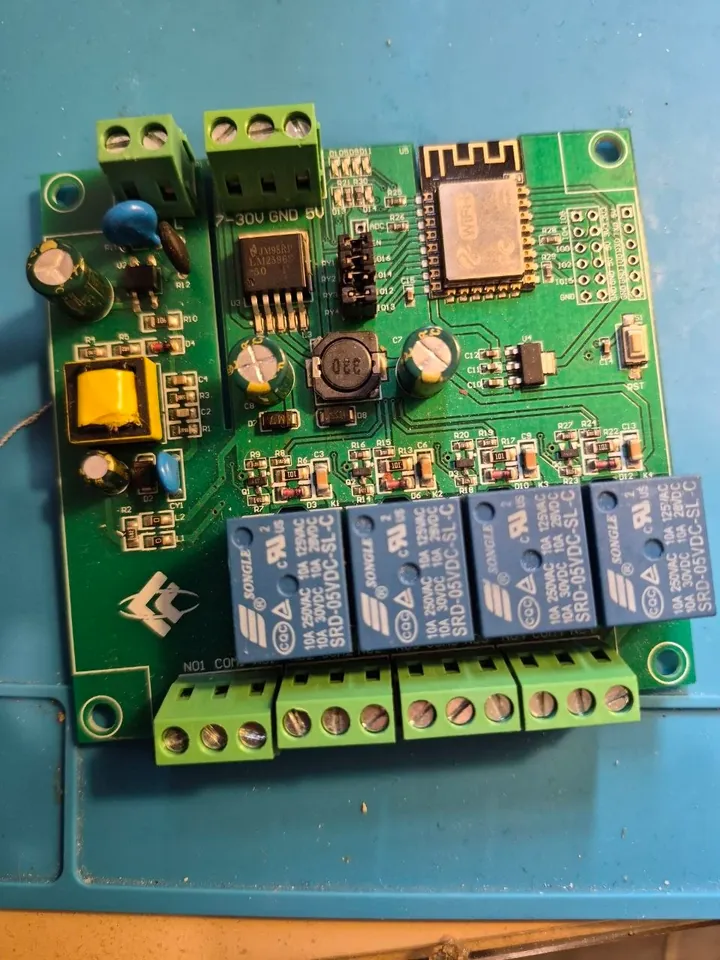
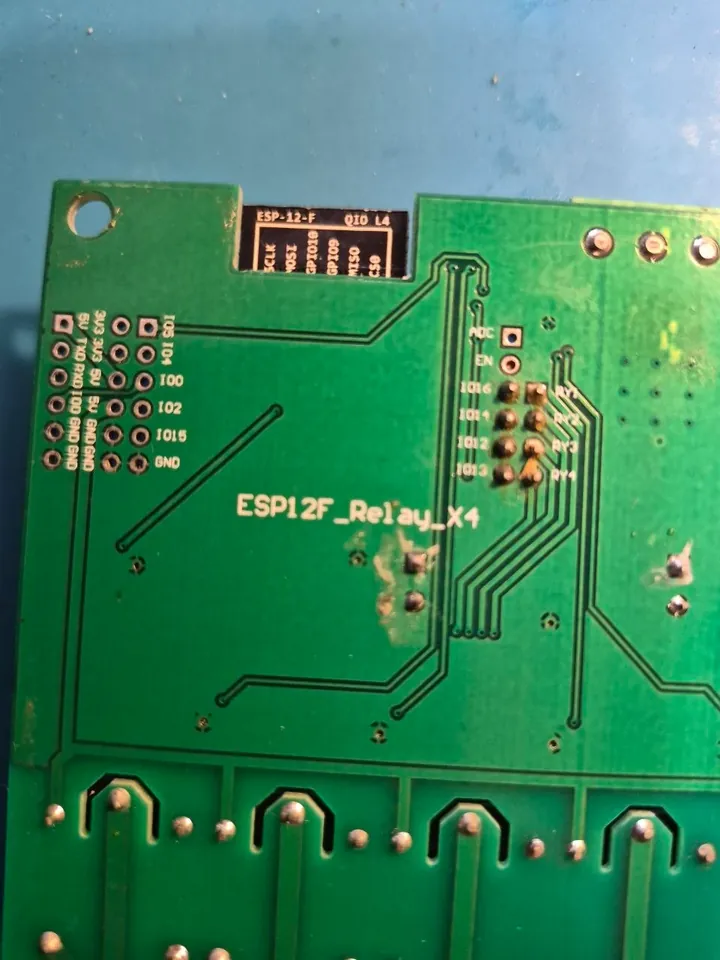

# LC-Tech ESP-12F relay x4 (ESP8266) on ESPurna

A 4-relay board printed **ESP12F_Relay_X4**: an ESP-12F module, four 10 A relays with NO / COM / NC terminals, and two
ways to power it: AC mains (its own converter, terminal on the left) or 7-30 V / 5 V DC (the 3-pin terminal next to it,
LM2596 step-down). A RST button, every free GPIO on a header.

  
  

## Image and pins

`esp8266-1m` with the *LC Tech ESP12F Relay X4* device template (the module has 4 MB, the boards here were installed
with the 1 MB layout):

| Function | GPIO |
|----------|------|
| relay 1 | 16 (jumper RY1) |
| relay 2 | 14 (jumper RY2) |
| relay 3 | 12 (jumper RY3) |
| relay 4 | 13 (jumper RY4) |
| button | 0 |

The relays reach the ESP through the four jumpers between IO16 / IO14 / IO12 / IO13 and RY1-RY4: pull a jumper and that
GPIO is free for something else. IO5, IO4, IO2 and IO15 are on the header for buttons or
sensors.

## Flashing

The header has 5V, TX, RX, IO0, GND and 3V3: RX / TX to the adapter, IO0 to GND while powering up (or pressing RST)
enters the ROM bootloader. After the first flash updates go over Wi-Fi, two steps on the 1 MB layout.

## Tested

The board type runs a board build of this fork (`esp12f-relay-x4`, 1 MB layout) in the home fleet; not yet the generic
`esp8266-1m`.
