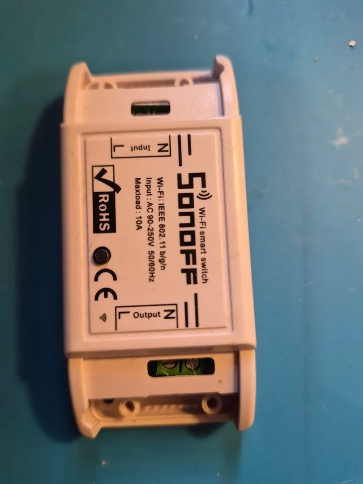
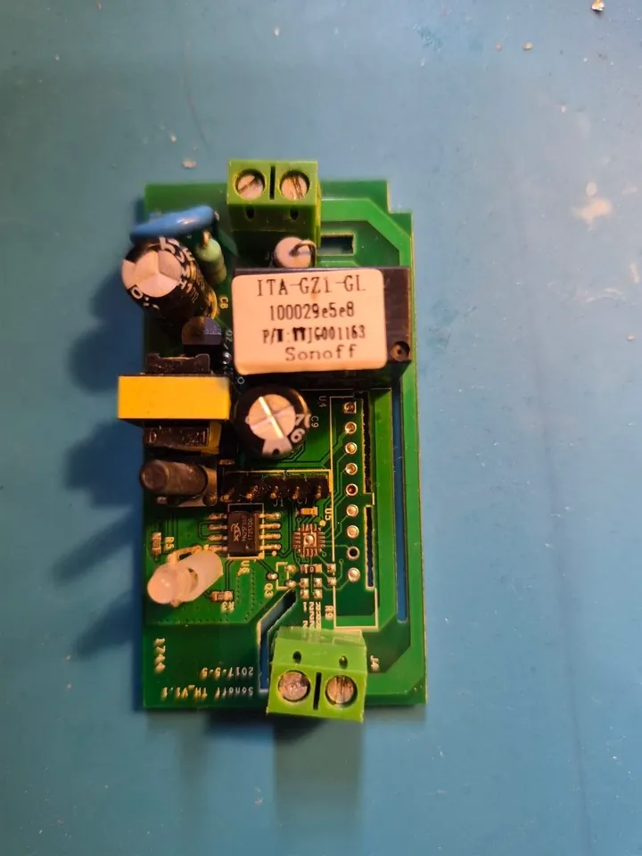
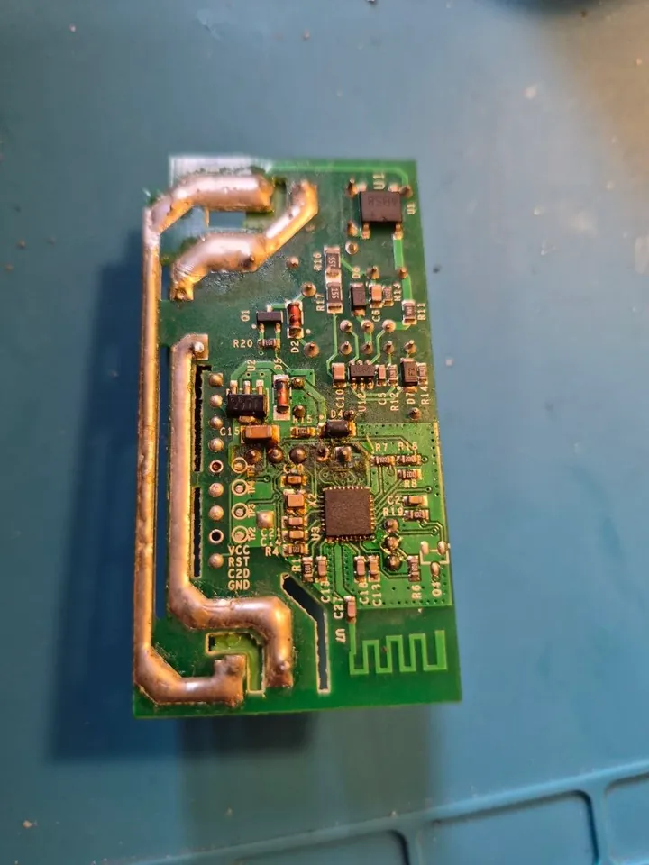
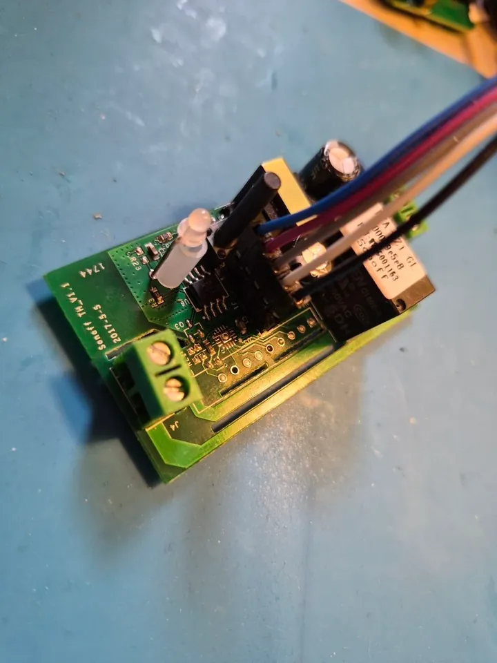

# Sonoff Basic (ESP8266) on ESPurna

The classic Itead 1-channel relay, 10 A, mains powered. ESP8266 with 1 MB flash.

  
  
  

The board of the unit here is printed *Sonoff TH_V1.1 2017-5-9* (no sensor jack fitted) and runs with the pins below.
Other revisions: the
[Basic R2](https://templates.blakadder.com/sonoff_BASICR2.html) (Tasmota Device Templates).

## Image and pins

`esp8266-1m` with the *Sonoff Basic* device template (*ADMIN → Device Template*, `sonoff basic`):

| Function | GPIO |
|----------|------|
| relay | 12 |
| button (on the case) | 0 |
| LED (inverse) | 13 |
| free pin on the header (a wall switch) | 14 |

A second wall switch on GPIO3 (RX) needs `uartRx0 153` so the serial port does not take the pin; a second relay output
on GPIO16 is a modification of the board, not stock.

## Flashing

The header next to the button has 3V3, RX, TX, GND (and GPIO14 on the original Basic). Hold the button while powering up
from the adapter's 3.3 V (never from mains with the adapter connected) and write `espurna-esp8266-1m.bin` at `0x0`. After
that every update goes over Wi-Fi in two steps (the mini first), from *ADMIN → From GitHub*.

## From ESPurna 1.15, without a wire

One retired Basic came back with ESPurna 1.15 (2021, core 2.7.4) and about 10 KB free:

1. Its terminal answers only to the WebSocket action `dbgcmd`; `keys` there gives the settings to back up.
2. A web upload of the mini dropped at 73 %, and 1.15 then kept the update 'in progress' (ArduinoOTA answered
   `Update.begin` errors) until a `reset`.
3. After the reset, at 70 s uptime, the mini went on with ArduinoOTA (`espota`) in 14 s.
4. The mini came up on the same address with the Wi-Fi of the 1.15 settings; the full `espurna-esp8266-1m.bin.gz` was
   uploaded on the mini page (its download of the full image failed on the 1.15 settings pool, 500 «cannot write the
   settings»).
5. ESPurna migrated the settings (cfg 11 → 17): Wi-Fi, hostname and password stayed. Then the template.

## Two-step update from the WebUI

Tested on this board with the memory fix (lwIP 'Lower Memory', no API handlers while the API is off): the page uploaded
the mini in 7 s, the mini downloaded `espurna-esp8266-1m.bin.gz` (542 KB) from GitHub, checked its SHA-256, wrote it
and the board was back in 101 s, settings and relays as before.

On release 371526da (before the fix) the same board has 9-11 KB free and a largest block of 4-7 KB: the admin page loads
truncated (`ERR_CONTENT_LENGTH_MISMATCH`) on most tries, and when it did load the mini upload stopped at 52 %. Such a
board gets to a fixed release with the mini over ArduinoOTA, as above.

## Tested

The relay, the template, the WebUI, the two-step update from GitHub, the way from 1.15. Not checked by hand on this
board: the button, the LED blinking.
