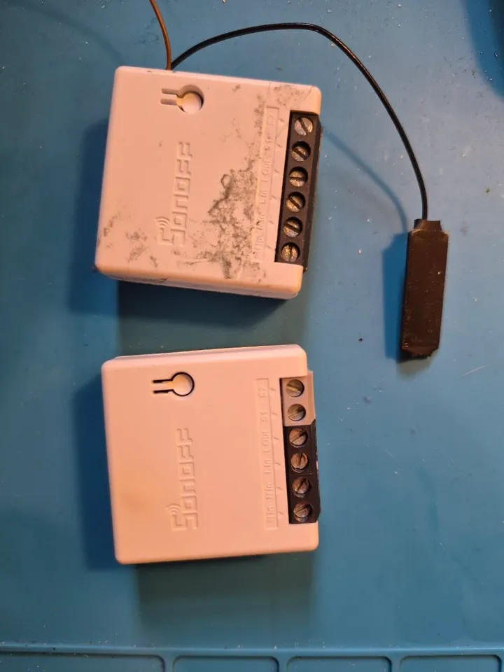
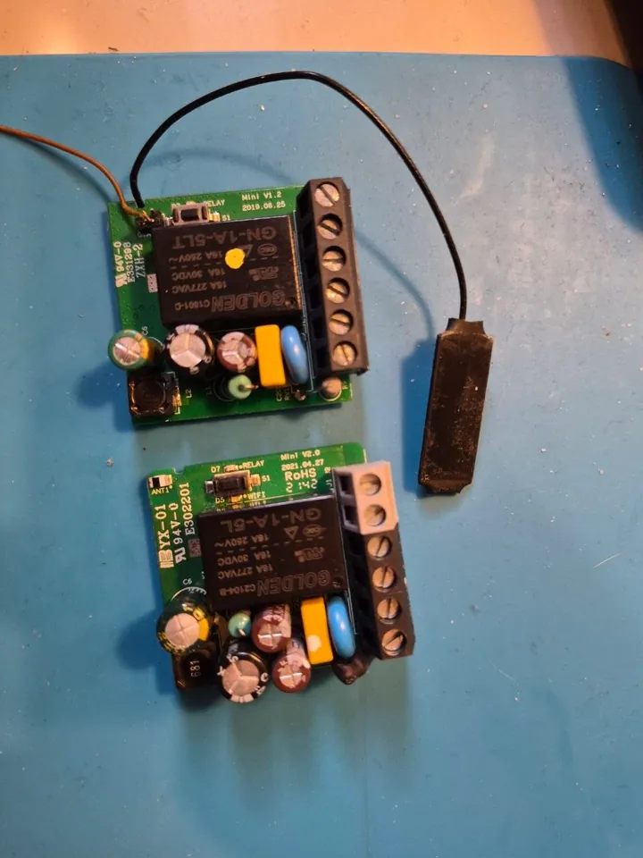
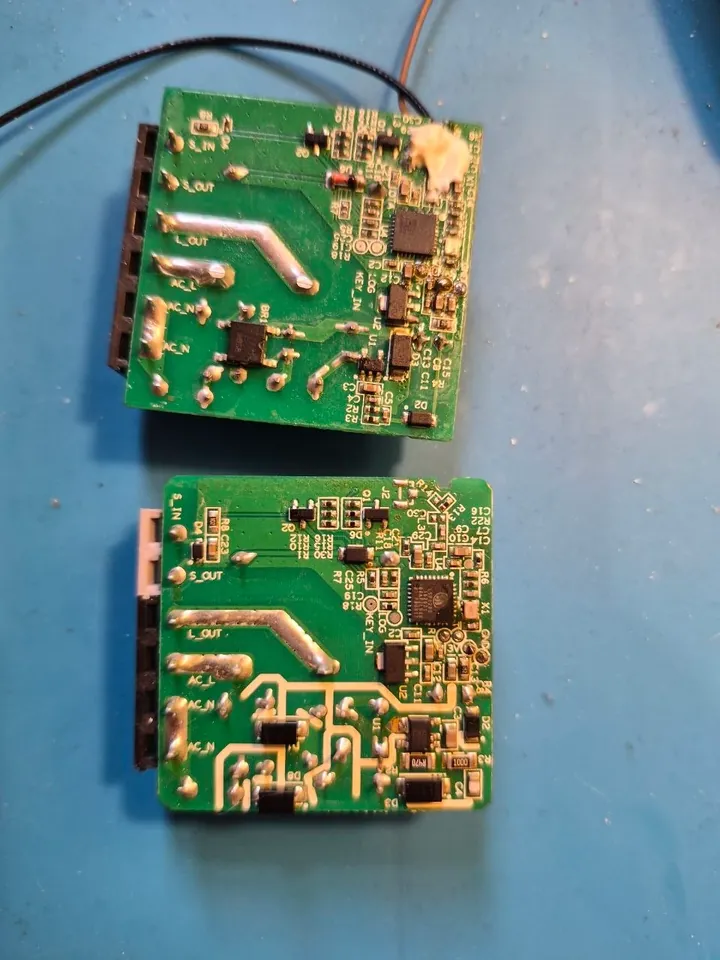

# Sonoff Mini R1 / R2 (ESP8285) on ESPurna

An in-wall 1-channel relay, 10 A, with an S1 / S2 input for the wall switch. ESP8285 (ESP8266 with 1 MB of flash inside
the chip). R1 and R2 run the same image; they cannot be told apart over the network.

  
  
  

Top: a Mini **V1.2 2019.06.25** (R1) with a wire on its GPIO16 pad for an extra button, below: a Mini **V2.0
2021.04.27** (R2), its S1 / S2 terminals are the grey pair. They are told apart by
the version printed on the board, not over the network.

## Image and pins

`esp8266-1m` with the *Sonoff Mini* device template:

| Function | GPIO |
|----------|------|
| relay | 12 |
| button (on the board) | 0 |
| S1 / S2 (wall switch) | 4 |
| LED (inverse) | 13 |

## A second wall switch and a mirrored lamp

Seven Minis in the walls of one house run with a second wall switch and a *dummy* relay (`relayDummy 1`, no pin) that
mirrors the lamp of another board over MQTT (both relays publish and subscribe the same topic, so either switch turns
either lamp). The second switch goes on a spare pin:

- **Mini R1**: GPIO16 is brought out to a pad, a wire there takes an external button or a second wall switch without
  touching the serial port: `btnGpio2 16` plus the button keys below.
- **Mini R2**: no free pad, the extra input goes on GPIO3 (RX): `btnGpio2 3`, `btnMode2 switch`, `btnDefVal2 initial`,
  `btnPinMode2 pull-up`, `btnPress2 relay-toggle`, `btnRlse2 relay-toggle`, `btnRelay2 1`. The serial port leaves GPIO3
  to the button by itself (the log says `[UART] GPIO3 is used by btnGpio2, the serial port leaves it`), the serial log
  and terminal keep TX. Older firmware needed `uartRx0 153` for that; the RELAYS panel shows the pins under *Serial port*.

These keys belong to the board, not to a build: keep them across reflashes.

## Nuances

- **In walls there is no wire**: updates only over Wi-Fi. The 1 MB layout makes it two steps (the mini, then the full
  image). One Mini whose power supply was dying rebooted in the middle of step 2 and never came back. Before an update
  read `last reset reason` in `info`: a hardware or software watchdog, an exception means the board is unstable.
- **SDK 2.2.x Wi-Fi crashes** (`sta_input`, RSN IE) hit several Minis; the images are on SDK 3.0.5 since.

## Tested

Relay, button, S1/S2, the second wall switch on GPIO3 / GPIO16, the dummy relay mirror, MQTT, Home Assistant, two-step
updates over ArduinoOTA. These boards run a board build of this fork (1.22, `itead-sonoff-mini`), not yet the generic
`esp8266-1m`.
